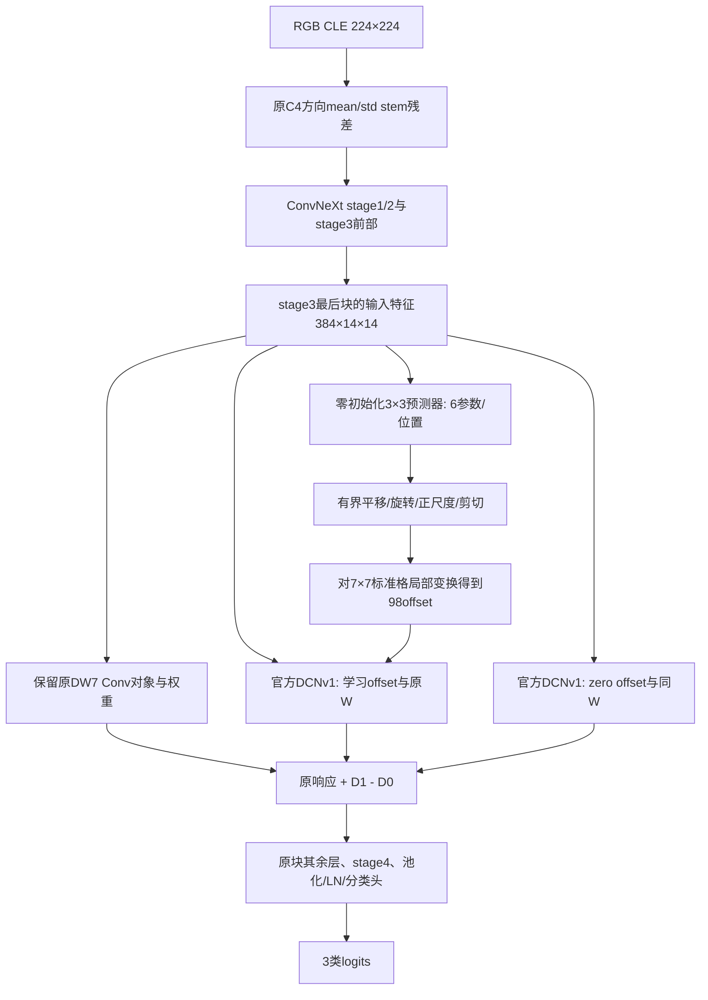

# CLE局部几何结构：实际开训、结构与使用说明

本文件是启动快照，不能代替完整三seed效果。上一跨尺度12模型全部完成并审计，未达标且不保留该全局读出；当前保留原M方向矩工作结构，新增局部几何适配与三个机制对照，共12项正式训练。固定B0和A–C清单保持冻结。

快照时间2026-10-25T02:54:31.665703+08:00；config SHA 3432da211c08f03d5984dd3d86bb4c9acc874e1171032a7d63270dd75745f682。

## 结构与可验证贡献



方向矩与局部几何作用于不同层级，是否互补必须由累计与去一结果验证。局部A的det>0仅约束每个采样基，不能称全局无折叠、整网等变或临床拓扑正确。双D都保留梯度，zero时严格前向相消，并非detach修正。

|方法|方向矩|采样控制|参数|单视图逻辑GFLOPs|
|---|---|---|---:|---:|
|plain|否|原baseline|27,822,435|8.909531|
|mom_affine|是|局部有界仿射|27,861,705|9.134721|
|affine_only|否|去方向矩|27,843,177|8.932411|
|mom_permuted|是|同六参数offset点固定打乱|27,861,705|9.134721|
|mom_dcn|是|成熟98自由offset DCN|28,179,749|9.259358|

逻辑FLOPs含两次DCN的线性收缩MAC与原Conv/新预测器/C4，但不含双线性插值、归一化、逐元素/池化/访存，实际代价以吞吐、耗时和显存为准。C4每模型四倍前向；三seed均值不是三模型集成。

## 已完成数值核验与资源实测

原型通过NumPy直接双线性/独立grid_sample输出及输入offset/权重三梯度、double gradcheck、局部det、公开MomTiny224初始化logit/原参数ID/RNG和有限反向；原型CLE图与CLE训练0。正式CPU所有四arm同公开起点逐位一致；真实batch32两次AMP更新全部有限、几何预测器从首步获得非零梯度、两步offset非零；原B0/Mom的六个完整427验证概率复现最大差全0.0。CUDA offset反向可能有原子归约，保存种子/环境/配置/实际权重SHA，不承诺GPU训练逐位确定。

|内核|1并发样本/秒|2并发总吞吐|4并发总吞吐|97%策略cap|实际同方法任务数|
|---|---:|---:|---:|---:|---:|
|mom_affine|403.60|383.37|415.98|1|≤1|
|affine_only|437.22|418.87|455.52|4|≤3|
|mom_permuted|401.63|380.75|414.91|4|≤3|
|mom_dcn|402.79|381.87|414.70|1|≤1|

每arm只有3个正式seed，cap4实际最多3任务，不能把四任务性能测量说成四个正式模型同时训练；真实并发与端到端吞吐继续按日志记录。代码按显存/CPU/吞吐决定扩容，未沿用旧6/8硬上限，保留6GiB余量。不能为填满4而制造无价值训练。

最近60条独立记录平均GPU 89.77%、CPU 6.31%、I/O wait 0.0021%。实际worker核对/proc后已记录训练epoch/2077索引/sps/等待。采样器只读主机和已确认自身worker/DataLoader子进程，原profile及每epoch日志保留。

## 训练、复现与使用

train2077/182患者、val427/39、test576/41，原3595物理cache仅按允许A–C索引读取。60epoch/batch32、原encoder1e-5、新方向矩/预测器/头1e-4、AdamW.05/cosine0/clip1/AMP、原HV/rotation15、worker2/thread1，全部来自同公开ImageNet权重与配对seed头，不热启动旧模型。原0度val最早最高F1选权重；完整组后再test反馈下一结构。当前协调器已运行，不能重复启动bootstrap制造重复训练。入口experiments/ac_affine_geometry_structure_window01/bootstrap_module_structure.py，先核查各identity与实际/proc。

完成真实checkpoint后使用：

```bash
cd /home/login/data/cle/auto/GPT
/home/login/miniconda3/envs/sunfuxiang/bin/python experiments/ac_affine_geometry_structure_window01/predict_module_model.py --arm mom_affine --seed 45 --image /absolute/path/image.png --views single --output /absolute/path/prediction.json
```

脚本拒绝未完成或SHA不符权重，类别ID0/1/2，恶性ID1。权重服务器weights/ac_affine_geometry_structure_window01/<job>/model_best.pth，真实SHA/签名在runs/<job>/complete.json；固定首val单图CLI smoke完成后见usage_smoke/independent_cli_audit.json，不以单图或单seed称有效。

## 研究与解释边界

共享LDConv/官方输出和输入梯度对齐，同时实测其bias非零、0.1hook不改变参数梯度及右下角权重和4的共同边界语义；本轮采用独立验证的官方DCNv1零填充，不称LDConv/FADC完整复现。FADC需要当前缺失的MMCV，未改旧Torch环境；DCN、LDConv、FADC、AffineFormer等已有形变/局部仿射相关先验，不把成熟概念或组合自动称SCI创新。详见MODULE_DIFFERENCES_ZH.md及原型upstream来源。

旧test已查看，A–C构造用过其标签，用户明确test参与后续设计。所有结果为自适应内部开发，患者20k配对bootstrap仅条件区间，不校正筛选偏差，不称独立泛化或全新外部验证。原M方向矩+C4对B0仅+1.476485pp，严格低于1.5。当前12模型需完成全部seed/指标/混淆矩阵/预算/源码与权重SHA/逐图预测独立审计；门槛严格平均Δ>0.015、跨seed正、区间下界正及Fraction3/200复算不变。一般阴性继续研究，不保证提点、新颖或录用。

数值元数据补充：preflight中mom_permuted的local_determinant_range指打乱前生成offset的A；打乱后的采样格不再是该局部仿射映射，不能据该数值宣称保持方向。CPU独立最小二乘拟合和offset边际精确核验见preflight_geometry_scope_audit.json；原预检/源码/config/训练均保持原样。
