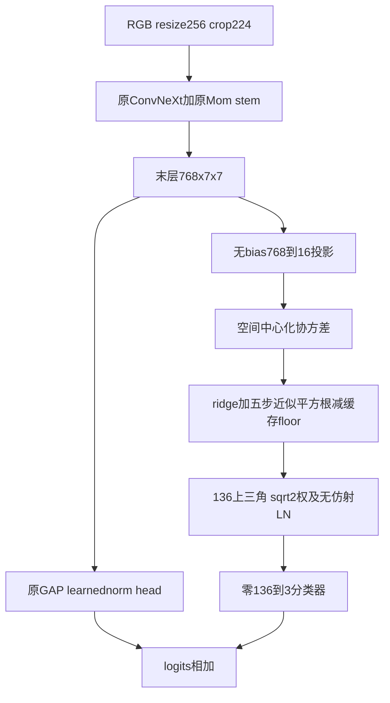

# CLE同层通道协方差：结构、实际训练与使用

本说明在训练进行中补充登记；source/config/12直接比较已于训练前冻结。此前额度故障未执行文档助手创建，不伪称本说明事前注册或Agent持续在线。原CNNMom保留，LAG全轮未确认新增间隔贡献。本轮检验同层通道联合变化。
快照2026-10-25T12:17:33.901993+08:00；config SHA 39784a3ff65fd551a94c6b99602dece33520ac2cc008ff0626a05a23c17caa8f；当时完成13/15。



## 冻结结构与训练协议

# 同层通道协方差谱描述：无CLE图像CPU原型

LAG全轮10门槛均false，完整对原Mom未确认增量，累计对错序/重复/成熟ACF区间均跨0；保留原CNNMom。下一假设为末层同一空间位置上的通道联合变化，补充stem方向统计。既有CROSS是stage3/4跨层相关；本次为单层对称协方差，不能把不同实现混称旧结果复现，也不能忽略旧阴性。

末层768×7×7经共享类型但独立实例的768→16无bias可学习1×1投影，共12288参数。逐通道空间中心化后C=XXᵀ/49。主分支对C+1e−4I做trace预归一、5次Newton–Schulz矩阵平方根迭代、sqrt(trace)后补偿，再减同迭代的固定ridgeI平方根floor。取上三角且非对角乘sqrt(2)，136维经无仿射LN eps1e−5、零136→3投影（411参数）加原logits。原avgpool/learned norm/head保留，新增总12699参数。floor只固定平移以令平坦描述为0，不增加信息；有限5次是平方根近似，不称精确eig平方根。

五arm：mom_covsqrt；covsqrt_only真去18528Mom；mom_rawcov相同投影下直接C、同136/LN/零分类器；mom_diag先清空非对角再同ridge/5次迭代，仅保留16个有效对角描述，上三角其余坐标恒0，名义参数相同但有效容量并不相同，明确作为去通道耦合控制；mom_channelperm对每个投影通道施加独立固定49位置置换（np.default_rng(20261025)），保留全部单通道边缘分布但改变联合配对，再算相同协方差平方根。mom_only/plain只作公开初始化参照。

协方差/矩阵平方根/谱归一是成熟方法。主要来源：[作者iSQRT-COV页面](https://www.peihuali.org/iSQRT-COV/index.html)、[作者官方实现](https://github.com/jiangtaoxie/fast-MPN-COV/blob/master/src/representation/MPNCOV.py)。官方source blob400cdf16469d9a729fda31a4a310708fd365b895，MIT LICENSE blobfcd5240305399993bb1479b8ac45cc147e77c991，均保存原字节/归属。本地无BN/ReLU投影、ridge/floor、Frobenius加权上三角、LN及保留原GAP的零logit分支是明确适配，不是官方ImageNet整网或全部MPN-COV复现，不据组合称新颖。官方数值oracle仅审阅后受限提取Covpool/Sqrtm，不运行其训练入口。

全局共同空间排列/旋转不改变该描述；独立每通道置换改变联合统计。这不是整CNN等变或病灶定位/临床拓扑。rank16与49样本、ridge绝对尺度及有限迭代均有限制；不保证稳健影响函数。LN后不保留协方差正定矩阵含义，不称黎曼网络。原始C半正定、加ridge仅对迭代矩阵确保正定，减floor/取向量后的表示另当别论。

零分类器首步使上游新增1×1投影梯度为0，这是链式法则，不伪称首步各投影梯度全正。必须检查分类器首步非零、第二次更新后1×1投影非零且所有梯度有限；保留Mom的梯度单独检查。新矩阵乘法MAC明确计入，排除统计中心化/LN/逐元素/访存；固定floor在构造时预计算、不计前向。

CPU阶段做独立NumPy公式/5步迭代/eig误差、官方受限AST数值/梯度、同边缘异耦合反例、gradcheck/退化有限/批独立/两合成更新、三seed×七变体公开起点logit/RNG/原参数对象一致。所有CLE训练/val/test图均0。只有通过后再独立正式注册、原M同recipe 60epoch/三seed，六完整427val真实权重重建、CUDA32两更新和吞吐预检通过后才开训。标签/等级/split/采样均不改，原Mom及固定B0三seed有效参考不重训。全部test自适应内部开发，条件CI不校正选择偏差；整体active，不保证提点、SCI新颖或录用。


## 正式十五模型事前注册

五arm mom_covsqrt/covsqrt_only/mom_rawcov/mom_diag/mom_channelperm×45/46/47各60epoch/batch32。原Q/M A224同recipe：公开ImageNet及相同seed head，原CE，encoder1e-5、新模块/head1e-4、AdamW.05、cosine0/clip1/AMP、stochasticdepth.1、HV翻转/15度旋转/随机224裁剪、workers2/thread1。原CNNMom与固定B0有效三seed复用，不更换或削弱基线。CPU原型channel_covariance.py与原Mom逐字复制；library_cle必须用包含协方差和NS BMM的counted_flops。

固定AC train2077/182患者、val427/39、test576/41，恶性1，患者可多标签。标签/等级/阈值/清单/患者互斥split与采样不改。物理3595缓存不等于训练3595。每epoch2077唯一白名单SHA e8fe76bbcf6d8faf8dcb6f38a148341ffe81d10ac0cdc3e4dc38e9f8ccafd691。全部60epoch原0度val最早最大macroF1选权重，每组三seed完成后登记实际checkpoint再test四角度；独立直接像素与T TestData A路线完整427val和576test概率审计。

直接预注册mom_covsqrt对原Mom/covsqrt_only/mom_rawcov/mom_diag/mom_channelperm/固定B0两mode共12比较。三配对seed、整数Fraction及41患者20k条件区间；同C4 B0/DINO/Swin及成熟ECA/aug保留。数值门槛为平均差严格>3/200、三seed全正及条件区间下界>0。全部test为用户授权自适应内部开发，CI不校正选择偏差，非独立泛化或外部验证。去Mom正增量支持原Mom，不能倒置为新分支增量。一般阴性不停止整体研究。

正式CPU及真实CUDA batch32两次有限更新必须按链式规则核验：readout.classifier首步梯度>0；readout.project首步==0、第二步>0；保留Mom首步>0，去Mom真移18528，所有梯度有限。不能把上游首步0当故障或伪称两个新投影首步均正。mom_only须实际strict load原M三权重；加B0共六完整427val概率误差必须严格0。缓存SHA/训练拒绝test/2077白名单、每完整arm实际吞吐/6GiB余量/97%最小并发规则全过才开训。5次平方根为近似；diag名义136但仅16有效坐标，非等有效容量。逻辑2FLOP/MAC计新Conv/Linear、协方差BMM和5次各3个BMM及原三额外旋转卷积，固定floor仅构造，统计中心化/LN/逐元素/访存不计，实际吞吐另测。

## 正式CPU和CUDA核验

正式CPU逐字复制原型、真去Mom、原参数对象/公开logit/RNG/有限反向通过。真实CUDA batch32各arm两次有限更新：零分类器首步梯度>0；上游1x1投影首步==0、第二步>0；保留Mom首步>0，全部梯度有限。原Mom与固定B0共六完整427val概率重建严格0，缓存SHA/2077白名单/训练加载拒绝test通过；预检test推理0。

|arm|参数|逻辑GFLOPs|
|---|---:|---:|
|plain|27822435|8.909531136|
|mom_only|27840963|9.111840768|
|mom_covsqrt|27853662|9.113193776|
|covsqrt_only|27835134|8.910884144|
|mom_rawcov|27853662|9.113070896|
|mom_diag|27853662|9.113193776|
|mom_channelperm|27853662|9.113193776|

逻辑2FLOP/MAC含三额外旋转卷积/新Conv与Linear、协方差BMM和5步各3次BMM，缓存floor仅构造；中心化/LN/逐元素/访存不计。diag名义136坐标只有16有效，非等有效容量；5步为近似，不称精确eig或黎曼网络。

|arm|1并发图秒|2并发总图秒|4并发总图秒|cap|
|---|---:|---:|---:|---:|
|mom_covsqrt|875.80|844.53|848.24|1|
|covsqrt_only|1062.60|1055.19|1059.50|1|
|mom_rawcov|878.45|847.96|850.64|1|
|mom_diag|872.83|841.26|847.97|1|
|mom_channelperm|868.20|845.53|847.21|1|

选择实测最佳97%内最小并发，保留6GiB余量。cap不等于实际并发。真实PID/PPID/launch持续采样；此快照只含最新60行，均值不代替全轮时间加权值、不外推无训练队列阶段。

## 使用

只使用真实完成且SHA核对的权重，管理器已运行，勿重复启动。

```bash
cd /home/login/data/cle/auto/GPT
/home/login/miniconda3/envs/sunfuxiang/bin/python experiments/ac_channel_covariance_structure_window01/predict_module_model.py --arm mom_covsqrt --seed 45 --image /absolute/path/image.png --views single --output /absolute/path/prediction.json
```

RGB原图双线性resize256/中心224/ImageNet归一，类别0/1/2、恶性1。C4为四旋转概率均值，非三seed集成。weights/ac_channel_covariance_structure_window01/cov_<arm>_s<seed>/model_best.pth为实际权重路径。固定首val2386真实CLI对原batch32概率另外核验，通过helper后才称使用核验完成。

协方差/矩阵幂/归一化与组合均不自动新颖，无提点/SCI或录用保证。所有test为自适应内部开发，条件CI不校正选择偏差，非独立泛化或临床验证。整体研究active。
