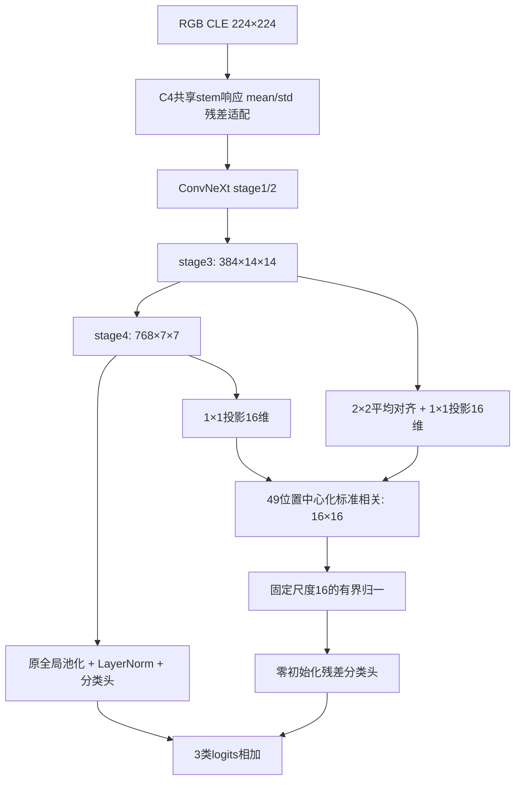

# CLE跨尺度结构研究：已实际开训

这是训练启动快照，不是结果报告。固定B0、原M方向矩工作结构与A–C清单保持冻结。当前4arm×3seed共12项已预注册并实际训练，不能把CPU原型验证说成CLE效果。

快照时间：2026-10-25T02:10:08.851033+08:00；config SHA：346b437341364f4cb8377dd251c7aa127b164aba25559ab713c3d283711dc69a。

## 结构及验证假设



方向矩处理早期方向离散度；新读出检验纹理与深层表征在相同位置的共同变化。它是否补足全局均值需正式配对结果，不以解释代替效果。整个网络不因此严格C4等变。

|方法|保留方向矩|空间对应|统计|新增读出参数|
|---|---|---|---|---:|
|mom_corr|是|真实|中心化标准相关|19,203|
|corr_only|否|真实|同上|19,203|
|mom_shuffle|是|固定打乱深层位置|同上|19,203|
|mom_bilinear|是|真实|成熟B-CNN非居中二阶+signed-root/L2|19,203|

mom_corr与原M方向矩比较新增读出贡献；corr_only去一，mom_shuffle同参数检验空间关系；mom_bilinear检查是否仅成熟二阶算子已足够。直接对照和Fraction严格门槛审计已在新三seed test结果产生前提交comparison_preregistration.json。全部newarm从同公开ImageNet重新训练，不用已训练权重热启动。

## 数值预检和代价

四arm初始化logit与原公开baseline完全一致，CPU NumPy/双精度gradcheck/常量/共同排列/平移检查通过；成熟B-CNN算子输出与输入梯度逐位一致。真实CUDA batch32两步AMP全部有限，第二步投影梯度非零，train/val描述子RMS约0.90–1.00，残差头有效更新。固定scale16按sqrt256维度设定，没用val/test分数搜索。六个已训练B0/方向矩模型在完整427验证图概率复现最大误差全部0.0。

|方法|参数|单视图逻辑GFLOPs|两步CUDA峰值MiB|
|---|---:|---:|---:|
|plain|27,822,435|8.909531|2327.1|
|mom_corr|27,860,166|9.113674|2569.6|
|corr_only|27,841,638|8.911364|2336.9|
|mom_shuffle|27,860,166|9.113674|2569.6|
|mom_bilinear|27,860,166|9.113674|2569.6|

原M方向矩27,840,963参数/9.111840768G，新完整结构27,860,166参数/9.113673728G；C4四视图逻辑前向乘4，三seed均值不是模型集成。FLOPs按2FLOP/MAC含功能C4卷积和相关bmm，排除归一化/逐元素/池化/访存，实际耗时看实测。

|内核|1并发样本/秒|2并发总吞吐|4并发总吞吐|选择并发|
|---|---:|---:|---:|---:|
|mom_corr|876.45|845.26|849.57|1|
|corr_only|1061.89|1053.60|1061.31|1|
|mom_shuffle|874.41|847.02|847.19|1|
|mom_bilinear|869.42|847.47|851.52|1|

最近60条独立采样均值GPU 91.78%、CPU 8.32%、I/O wait 0.002%。startup/加载权重/审计也在真实时间记录，不用峰值替代长期均值。正式phase采样器无GPU上下文，只读取自身已核对worker/DataLoader子进程及主机统计；profile另有原资源CSV，每epoch有加载等待/计算/峰值/sps。

## 执行、复现与使用

原train2077/182患者、val427/39、test576/41；原物理3595cache不等于训练用3595。训练LR/AdamW/增强/60epoch与固定B0相同；新模块按原新头组1e-4，原encoder1e-5。最早最高原0度val macroF1选权重，test反馈后续结构，不改变本轮epoch选择。全部日志/索引/最佳checkpoint/源权重SHA/有限值/逐图概率和患者指标由审计器复算，完成后自动做直接机制配对。

已经有协调器运行，不能重复执行bootstrap制造重复训练。入口文件用于审计/可复现：experiments/ac_crossscale_structure_window01/bootstrap_module_structure.py；真实当前身份以bootstrap_identity.json、manager_entry_identity_v2.json及/proc命令行联合核验。完成checkpoint后单图使用：

```bash
cd /home/login/data/cle/auto/GPT
/home/login/miniconda3/envs/sunfuxiang/bin/python experiments/ac_crossscale_structure_window01/predict_module_model.py --arm mom_corr --seed 45 --image /absolute/path/image.png --views single --output /absolute/path/prediction.json
```

脚本强制完成标记和权重SHA，未完成不会给随机预测。类别ID0/1/2，恶性ID1。权重服务器weights/ac_crossscale_structure_window01/<job>/model_best.pth；完成后的真实SHA在各runs/complete.json登记。

## 解释与论文定位

跨层双线性/二阶统计已有B-CNN、HBP等成熟研究，官方算子和模型适配差异见MODULE_DIFFERENCES_ZH.md、upstream/及reference_licenses/，不把跨层统计本身包装为创新。旧CPU原型scale1原件不修改，本正式版scale16和控制明确登记。是否有SCI可辩护的新机制需要结果和更完整文献比较，不保证新颖或录用。

历史test被查看，A–C构造用过其标签，当前用户明确test参与开发；全部结果为适应性内部开发。患者20k配对bootstrap只给条件不确定性，不校正选择偏差，不称独立泛化或全新外部验证。固定平均提升严格>1.5百分点、所有seed正且条件区间下界正门槛不放宽。上一轮阴性完整保存并已交付288文件包，整体目标仍active。
