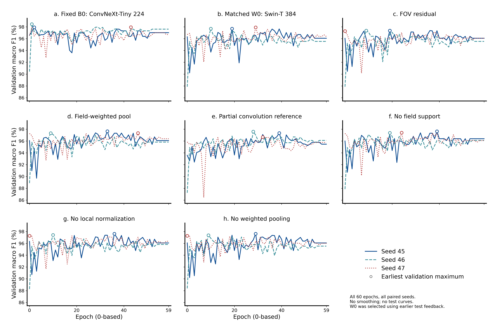
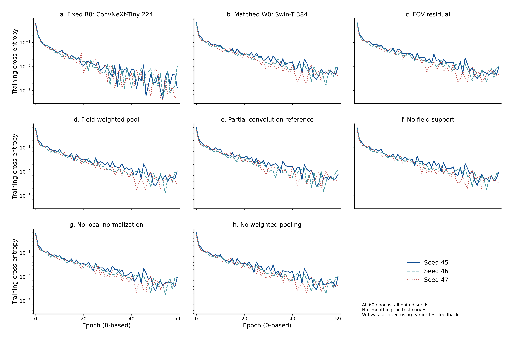

# 几何视场结构轮：完整结果与训练曲线

18个新增模型已完成60epoch并通过独立审计，所有seed、有效权重与阴性结论保留。另复用原B0及同骨干W0三seed日志，共24条训练曲线，不重复训练。

本轮没有确认视场掩码或局部归一化的可靠新增结构收益。最佳点估计的field_pool对固定B0仅+1.2972百分点，未超过1.5；对同骨干W0差值区间跨0，不能当作已证明有效的组件。该结论仅限这些已注册设计，不否定所有CLE上下文机制。

|方法|seed45 test F1|seed46|seed47|均值|对B0差（百分点）|对W0差（百分点）|
|---|---:|---:|---:|---:|---:|---:|
|fov_residual|95.4279%|96.6702%|90.8811%|94.3264%|-0.6550|-1.6172|
|field_pool|96.1807%|96.6580%|95.9971%|96.2786%|1.2972|0.3350|
|reference|95.9728%|95.2208%|96.3177%|95.8371%|0.8557|-0.1065|
|no_field|96.1452%|95.3111%|95.4225%|95.6263%|0.6448|-0.3173|
|no_local_norm|95.8354%|95.8390%|91.2839%|94.3194%|-0.6620|-1.6241|
|no_pool|95.2706%|96.3233%|90.9104%|94.1681%|-0.8133|-1.7755|

## 训练曲线和选择记录





图中保留每epoch原始值、所有seed，空心圆标出按原val最大值选择的最早epoch；train loss在全部值正时使用log轴，没有平滑或按test选择权重。高清PNG及可编辑SVG、矢量PDF均保存。

|方法|seed|最佳epoch|最佳val F1|最终val F1|最终train loss|最终train accuracy|AMP跳步总数|
|---|---:|---:|---:|---:|---:|---:|---:|
|B0|45|2|97.9240%|97.0129%|0.00132246|99.952%|5|
|B0|46|1|98.4525%|97.6103%|0.0106867|99.856%|5|
|B0|47|43|97.9327%|96.7014%|0.000531887|100.000%|5|
|W0|45|19|97.6955%|96.0707%|0.00938044|99.711%|4|
|W0|46|10|97.6955%|95.5365%|0.00910181|99.807%|4|
|W0|47|29|97.9009%|96.3583%|0.00399427|99.904%|4|
|fov_residual|45|19|97.3615%|96.0707%|0.00914518|99.663%|4|
|fov_residual|46|9|97.3615%|95.5365%|0.00980411|99.807%|5|
|fov_residual|47|0|97.2757%|96.0707%|0.00473155|99.856%|5|
|field_pool|45|33|97.6631%|96.0707%|0.0107882|99.663%|4|
|field_pool|46|9|97.3219%|95.8181%|0.00932297|99.807%|4|
|field_pool|47|46|97.3420%|96.3874%|0.00308775|99.856%|5|
|reference|45|39|97.3420%|95.4662%|0.00760159|99.663%|4|
|reference|46|28|97.5916%|96.1017%|0.0117111|99.759%|4|
|reference|47|32|96.6755%|95.7514%|0.00306214|99.904%|6|
|no_field|45|39|97.6460%|96.3874%|0.00951305|99.711%|5|
|no_field|46|19|97.3803%|96.1017%|0.00965512|99.807%|5|
|no_field|47|24|97.4085%|96.0707%|0.00316918|99.904%|4|
|no_local_norm|45|36|97.6285%|96.0707%|0.00941474|99.711%|4|
|no_local_norm|46|10|97.4162%|95.8181%|0.00951017|99.759%|5|
|no_local_norm|47|0|97.2757%|96.3583%|0.00449261|99.904%|4|
|no_pool|45|29|97.6285%|96.0707%|0.0101664|99.711%|4|
|no_pool|46|9|97.3803%|95.5365%|0.0100691|99.807%|5|
|no_pool|47|0|97.2757%|96.0116%|0.0043869|99.856%|4|

fov_residual、no_local_norm、no_pool的seed47均选择epoch0；这是按val规则计算所得，不能改挑后面的test较好权重。完整训练、每epoch2077唯一允许索引、有限参数及逐图概率已独立复核。这种曲线不支持机制跨seed稳定，描述性现象不等于已确定失败的因果解释。

## 预算与复现

|方法|参数|逻辑GFLOPs/图|预检训练峰值MiB|
|---|---:|---:|---:|
|plain|27,521,661|28.597872|7204.05|
|fov_residual|27,521,675|39.869364|10422.68|
|field_pool|27,521,661|28.597872|7207.84|
|reference|27,521,661|28.598167|7248.04|
|no_field|27,521,675|39.869364|10440.96|
|no_local_norm|27,521,675|39.869364|10423.99|
|no_pool|27,521,674|39.869364|10422.53|

权重保留于服务器weights/ac_field_structure_window01/<job>/model_best.pth；各权重SHA、逐图预测、accuracy、恶性召回、患者等权accuracy、混淆矩阵和条件bootstrap完整在原round_results.json/evaluations。训练源码/config/jobs不改；不要重新运行已完成18项。

```bash
cd /home/login/data/cle/auto/GPT
/home/login/miniconda3/envs/sunfuxiang/bin/python experiments/ac_field_structure_window01/predict_field_model.py --help
```

模型用法按原FIELD_STRUCTURE_AND_USE_ZH.md及predict_field_model.py参数选择真实完成的arm/seed与checkpoint。该轮已经结束，新的模块研究实际入口为experiments/ac_module_structure_window01/bootstrap_module_structure_v3.py，继续研究并保持目标active。

test按用户要求参与开发反馈，历史test已查看且A–C构建使用其标签；等级是模型一致性代理。条件患者bootstrap不消除选择偏差，不称独立泛化确认。成熟C4条件数值里程碑及匹配C4强参照另列，不混为本轮新结构有效性。
