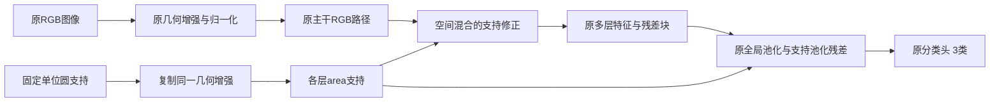

# 几何视场支持结构与复现说明

本文件对应独立正式实验目录：/home/login/data/cle/auto/GPT/experiments/ac_field_structure_window01。历史原型、共享module_library、历史冻结源码和权重保持原样。

## 当前实现与研究性质

已完成正式模型、配对数据、训练调度、逐组val/test独立审计、成本统计预检及单图使用入口的源码。初次部署的编译、合成Swin224 CPU零门初始化logits、优化器参数唯一覆盖和门学习率检查已通过；正式GPU检查以preflight.json为证，正式训练以runs中的日志和complete.json为证。不能把源码实现、CPU检查或等待器存活写成H1已经训练或有效。

固定主要baseline B0按前一资格阶段预先提交的val规则选定；工作起点W0从全部8种资格方案的完整3seed test均值选择。这是用户授权的test反馈开发。B0保持固定，W0的test选择和历史A–C构建依赖需披露。正式结果同时比较B0与同主干/分辨率/预算W0；后者用于判断几何机制本身是否带来收益。

## 数据通路与几何支持

RGB沿用W0同一预处理：A配方resize256/crop224，B配方resize448/crop384。训练使用原随机水平/垂直翻转、15度旋转和随机裁剪；验证/test中心裁剪。RGB按ImageNet均值标准差归一化。原图虽为灰度，仍使用原3通道RGB输入。

在resize正方形上用像素中心定义固定单位圆作为支持。支持只表示预先声明的采集几何，不根据亮度、标签、预测、等级或错误筛选。支持与RGB复制同一组随机几何操作；额外通道不消耗后续RGB的随机数。完整5008次train/val两配方RGB/label/weight/index/RNG一致性与160次RGBA空间对齐证据按完全相同源码SHA复用，正式GPU及全427概率检查另行执行。

模型输入为4通道张量；forward分开RGB和支持，RGB显式contiguous后进入原主干。支持按各空间尺度area下采样。它近似几何覆盖比例，不表示经过所有卷积感受野传播后的精确光学有效域。



CNN只替换第一个空间stem及深度可分离空间卷积；Swin还包装原窗口注意力。EfficientNet内部SE池化不改；只包装最终顶层全局池化。未声明修改的原主干算子继续使用原路径。

每处完整H1输出为 `原输出 + tanh(alpha) × (支持修正输出 - 原输出)`，alpha零初始化。卷积采用NVIDIA偏置修正公式并对完整H1归一化比值限幅4；窗口注意力按支持对key加对数权重，处理空窗口和人工padding；全局聚合按支持加权。零门应逐位重现原W0初始化logits，正式CUDA预检核验这一点。

这些成熟算子本身不声称新颖。待验证的是CLE几何支持、受限残差适配和层级部署的组合机制；没有性能证据或文献审查前，不能称为已成立SCI创新。NVIDIA算子直接参照仅复现算子公式，不等于其完整inpainting网络。共享库的FasterNet通道部分卷积与NVIDIA支持卷积不同；原核查、旧失败v1、修正v2及BSD许可均保留。

## 六个方法与公平训练

|方法|用途|
|---|---|
|fov_residual|完整几何支持残差机制|
|field_pool|成熟支持加权池化参照，无新增门|
|reference|直接NVIDIA公式适配，无残差门、无比值限幅|
|no_field|全1图像域支持，对照光学视场；仍保留人工padding处理|
|no_local_norm|去掉局部支持归一化，保留支持加权|
|no_pool|去掉最终支持聚合，保留局部修正|

每种seed45/46/47、60epoch，共18次新训练。已完成W0/B0完整训练与checkpoint复用，原W0不再次重训。所有候选从同一公开预训练和同seed头初始化起步，不从一个优胜模型额外续训。原encoder LR1e-5、新门与head LR1e-4，AdamW wd0.05，cosine到0，clip1，AMP，batch32。带门对照采用相同门数量和学习率分组规则；具体参数与FLOPs以正式预检记录为准。

checkpoint按固定val427最早最高macroF1选择。每方法完整3seed之后先登记源码/配置/权重SHA并Git提交，再对原test576/41患者推理。两套构造方式独立复算所有val/test概率，核验有限参数、原状态不变、样本身份、指标、混淆矩阵、实际train索引、预算和所有权。报告全部seed及患者配对条件bootstrap，不挑最高seed。

## 执行入口

Python：/home/login/miniconda3/envs/sunfuxiang/bin/python；SSH：ubuntu-server；Git：/home/login/miniconda3/bin/git。

bootstrap_field_structure.py按实际/proc命令等待资格主进程、资格bootstrap、test协调器结束，并要求全部24模型资格审计、15组/42独立权重反馈和B0冻结，然后顺序执行prepare、preflight、profile、run。启动状态读取launch.json、bootstrap_status.json、bootstrap.log及实际/proc命令；锁文件不能代替活进程证据。

正式冻结前修正过等待器的NUL参数解析；只替换自己的轻量等待器，没有模型训练产生或丢失。旧launch、Git源码和原因保留。后续源码修订若发生在config冻结后，须保留原版并显式新版本，而非改写已冻结来源。

阶段入口如下，活流水线运行期间由bootstrap调用；故障恢复先看具体日志、同流水线活进程和complete/checkpoint SHA，不盲目重新训练：

```bash
/home/login/miniconda3/envs/sunfuxiang/bin/python /home/login/data/cle/auto/GPT/experiments/ac_field_structure_window01/run_field_structure.py prepare
/home/login/miniconda3/envs/sunfuxiang/bin/python /home/login/data/cle/auto/GPT/experiments/ac_field_structure_window01/run_field_structure.py preflight
/home/login/miniconda3/envs/sunfuxiang/bin/python /home/login/data/cle/auto/GPT/experiments/ac_field_structure_window01/run_field_structure.py profile
/home/login/miniconda3/envs/sunfuxiang/bin/python /home/login/data/cle/auto/GPT/experiments/ac_field_structure_window01/run_field_structure.py run
```

continuous_resources.csv每2秒记录GPU、显存、CPU总/最高单核、I/O等待和RAM，包含审计期间；io_process_resources.jsonl记录物理磁盘与本流水线进程I/O。各epoch日志记录加载等待、计算时间、吞吐、峰值显存和实际索引集合。profile比较真实单任务和可容纳并发吞吐，按实测和余量调度，不固定沿用旧6/8上限。

## 已完成权重的单图使用

只有对应complete及validation_complete有效后才可使用。示例中的arm/seed用于指定模型，不代表挑最高seed发布：

```bash
/home/login/miniconda3/envs/sunfuxiang/bin/python /home/login/data/cle/auto/GPT/experiments/ac_field_structure_window01/predict_field_model.py --arm fov_residual --seed 45 --image /absolute/path/example.png --output /home/login/data/cle/auto/GPT/experiments/ac_field_structure_window01/exports/example_prediction.json
```

先创建输出父目录。脚本核验登记checkpoint SHA和冻结来源，生成同一单位圆支持，再输出3类概率和原类别ID（ID1恶性）。单图AMP可能与batch32存在极小概率差异；完整比较以逐图审计为准。模型工厂仍依赖已登记的公开预训练文件，之后严格覆盖完整训练状态。

本轮完成不代表整个目标完成。若H1有跨seed且对忠实/同预算参照及消融均合理的收益，保留它再加1–2个互补机制并作累加/drop-one重训；若阴性则据证据改机制，结果如实保留，不放宽1.5百分点门槛或虚称独立确认。
