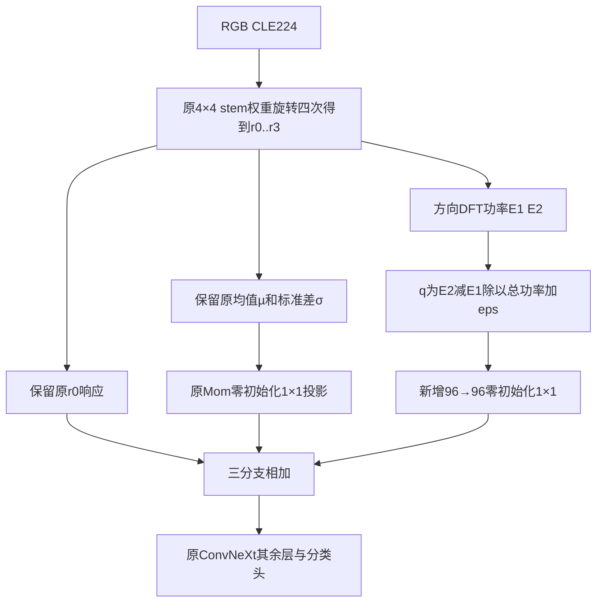

# CLE C4功率形状：实际开训、结构与使用

患者条件表征12模型已终态且全部8方案未达严格目标，未确认辅助对比目标优于原Mom。完整307文件包已交付并本地全SHA核验，原Mom及CE食谱保留。新轮五机制×三seed共15模型先冻结、CPU/CUDA预检、实测并发后实际开训。本文件为启动快照，不能当CLE提点结论。

快照2026-10-25T05:22:09.307357+08:00；config SHA 39c104371c68e014d4925a7daab9dd7da003f722ea2169bcdf9a802f84eec0a7。

## 结构与机制



µ/σ不能唯一确定E1/E2分配，已有合成反例/NumPy FFT/Parseval证明；这只是新增描述信息的数学证据。q在C4循环移位下不变，低能量有限，强度缩放因eps仅近似不变。普通网络尾部不受群约束，不能称整个CNN等变/不变，不能从频谱量直接推导临床组织结构。

|arm|机制|参数|单视图逻辑GFLOPs|
|---|---|---:|---:|
|mom_shape|保留µσ并加稳定功率对比q|27,850,275|9.169644|
|shape_only|真正去掉18528参数Mom分支|27,831,747|9.054038|
|mom_permuted|同响应边际/参数，固定非循环排列破坏邻接|27,850,275|9.169644|
|mom_duplicate|同新分支参数但重复原σ|27,850,275|9.169644|
|mom_rawh2|成熟原DFT第二频率幅值算子|27,850,275|9.169644|

额外分支9312参数、复用原四响应，保留原base/Mom分支对象与公开初始化RNG；shape_only不存在unused Mom adapter。原Mom为去q参考，五arm分别检验增量、去一、方向关系、重参数化和成熟幅值。逻辑2FLOP/MAC包括功能旋转卷积/模块1×1，排除功率/除法/逐元素/归一化/访存，不能当相同实际延迟；各arm独立实测。C4四倍前向，三seed均值不是集成。

## 数值与成熟参照

原型CPU通过NumPy FFT/Parseval、同µσ不同q、四循环/输入90°局部空间协变和错序破坏、低能量/常量有限、eps伸缩偏差、double gradcheck。官方H-Net纯幅值函数AST以受限NumPy/Torch shim核对输出/输入梯度，官方blob和MIT许可保留；不安装旧TensorFlow，不称完整H-Net/连续旋转网络或ECCV2018整法复现。共享FMA空间rfft2与方向轴变换不同。

原型最初启动器将字符串__file__传给Path-only SHA函数，在CPU检查前报错。原source/config/failure保留，独立修复运行器只补启动与登记，算子/测试不改；数值证明在修复后实际完成。正式CPU新增真正去Mom检查、七种公开起点初始logit/参数ID/RNG及有限梯度全部通过；真实batch32各arm两次AMP更新有限，新投影梯度非零，六B0/Mom完整427val概率复建最大差均0.0；物理cacheSHA和test训练加载拒绝通过。数值检查不能当CLE有效性。

## 全目标实际并发吞吐

|arm|1并发图/秒|2并发总图/秒|4并发总图/秒|97%策略cap|
|---|---:|---:|---:|---:|
|mom_shape|690.55|653.62|658.18|1|
|shape_only|787.25|751.92|751.87|1|
|mom_permuted|675.16|638.28|642.49|1|
|mom_duplicate|744.99|709.49|709.63|1|
|mom_rawh2|760.57|725.61|729.84|1|

按最佳实测97%内最小并发、6GiB余量选择；GPU满载且吞吐无益时不继续扩容。每arm仅3正式seed，cap4不能说实际四模型并行。原始profile和正式每2秒GPU/显存、CPU总量/每核、iowait、RAM、自身父/子进程与I/O持续采样，逐epoch等待/耗时/吞吐/2077索引SHA保留。启动快照短时平均GPU 48.25%仅指已采集的4行，不能替代完整长时统计。

## 训练、复现和使用

固定train2077/182患者、val427/39、test576/41，3595物理cache仅按允许A–C索引使用。固定B0不改，不更换标签/等级/阈值/split/筛图；原CE、60epoch/batch32、encoder1e−5、新分支/头1e−4、AdamW.05/cosine0/clip1/AMP、HV/rotation15/worker2/thread1。seed45/46/47从同公开ImageNet权重和配对头独立训练，无旧checkpoint热启动。原0度val最早最高macroF1选权重，完整三seed组再两路线独立val/test概率审计。当前管理器已经运行，不能重复启动bootstrap。

真实checkpoint完成后使用：

```bash
cd /home/login/data/cle/auto/GPT
/home/login/miniconda3/envs/sunfuxiang/bin/python experiments/ac_harmonic_partition_structure_window01/predict_module_model.py --arm mom_shape --seed 45 --image /absolute/path/image.png --views single --output /absolute/path/prediction.json
```

脚本拒绝未完成或SHA不符权重，RGB→256双线性→中心224→ImageNet归一；类别0/1/2，恶性1，C4四旋转概率均值。权重weights/ac_harmonic_partition_structure_window01/power_<arm>_s<seed>/model_best.pth，任务签名/SHA见complete.json。首个真实完成模型之后再固定首val图做CLI smoke，当前不将尚未执行的检查写成已通过。

## 评价和边界

所有15模型全部seed/阴性保留，报告macroF1、accuracy、恶性召回、患者等权accuracy、混淆矩阵和计算成本。直接比较完整mom_shape对原Mom、去Mom、错循环、重复σ、成熟幅值、固定B0，两推理预算分列。41患者20k配对bootstrap仅条件区间，独立整数Fraction门槛平均严格>0.015、三seed正且区间下界正；另核强同预算参照，不挑最高seed。

用户授权test反馈设计，历史test已被查看且AC构造用过标签，所有结果属于自适应内部开发，不校正选择偏差，不称独立泛化/全新外部验证。等级仅模型一致性代理。群/傅里叶/幅值均有成熟先验，组合不自动称SCI创新；不保证提点或录用，整体研究继续。
