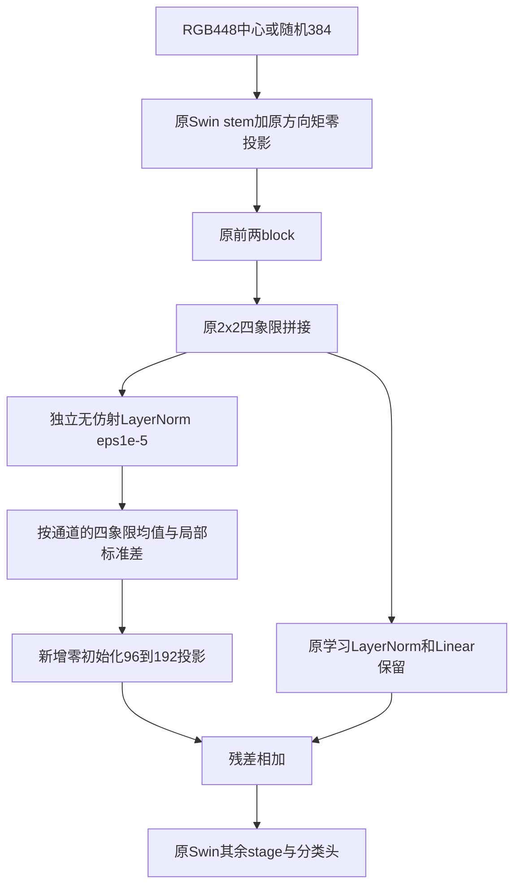

# CLE Swin方向矩迁移与局部空间对比：实际开训/复现/使用

POWER全15模型已经完整独立概率与直接Fraction审计，10方案均未达；392文件完整包本地逐SHA通过。q/rawH2/重复σ无确认增量，原方向矩和CE保留。新轮五arm×三seed共15模型，正式CPU/CUDA和原参考完整427概率重建通过后实测并发并开训，不能据数值预检称效果。

实际快照 2026-10-25T06:21:16.367957+08:00，配置SHA 1fdd3b28feff6181e6096897011ce96b58744a3e94b31fb37ab08bfb501c7355。

## 结构



h=sqrt(mean_q((u_q-mean_q u)^2)+1e-6)-.001；不带仿射LN避免各象限gamma/beta破坏统计置换性质，原learnedLN继续原主支。平坦h严格0，eps下强度缩放近似；不保证普通Swin整网旋转等变/临床拓扑。标准统计/LN/残差和Haar关系已有成熟先验，组合不自动SCI创新。

|arm|参数|逻辑GFLOPs|
|---|---:|---:|
|plain|27,521,661|28.597872|
|mom_only|27,540,189|29.192414|
|mom_local|27,558,813|29.277349|
|local_only|27,540,285|28.682806|
|mom_mean|27,558,813|29.277349|
|mom_global|27,558,813|29.277349|

mom_only是原Mom的Swin迁移去local参考；mom_local累计；local_only真去Mom；mom_mean同参数均值控制；mom_global相同h先空间均值后广播，移除局部位置。额外merge18624参数，原Mom18528，原对象/参数/RNG/公开logit保持，没有已训练权重热启动。Swin384成本约29.3G，固定B0仅8.91G，不隐瞒差异；还要看同Swin父模型和同C4参照。逻辑2FLOP/MAC含Swin功能attention/三旋转卷积/新Linear，排除LN/统计/逐元素/访存，不当真实耗时。

## 训练和数据

固定AC train2077/182患者、val427/39、test576/41，患者可多标签、恶性1，标签/等级/阈值/清单/split/采样不变。每epoch2077唯一索引SHA，B缓存原图RGB resize448/2504图仅train+val，独立T test576×448，均原图SHA来源核验，绝非256缓存上采样。原Q公开ImageNet、stochastic depth .1、60epoch/batch32、encoder1e-5/新增模块与head1e-4、AdamW.05/cosine0/clip1/AMP、HV/rotation15/randomcrop384、workers2/thread1。原SwinB三seed有效权重复用，固定B0不改；工作SwinB基于历史test选择需披露。

原0度val最早最高macroF1选权重，三seed完整后才注册并测single/C4，完整427val/576test的直接像素路线与独立T TestData B加载路线审计；权重有限/source/job/checkpointSHA/整数混淆矩阵与41患者20k条件bootstrap。对mom_local预注册mom_only/local_only/mom_mean/mom_global/SwinB/B0两路线直接控制。test为用户授权自适应内部开发，历史查看/AC构建用标签，不称独立泛化，bootstrap不校正选择偏差。

## 数值与成熟参照

原型NumPy pad/四象限/LN/方差和独立正交Haar功率oracle、同均值不同局部对比、local/global区别、偶数90度描述协变/奇数右下pad原样保留、常量低能量有限、doublegradcheck、两合成更新通过。官方Microsoft PatchMerging受限AST和安装Torchvision在偶数输入输出/输入及所有参数梯度严格一致；原码拒绝奇数，runtime支持，不能混称。保留官方源/blob和MIT及Torchvision BSD许可；没有声称HWD整法复现。正式6种公共Swin384初始logit/RNG/原参数ID/有限反向与预算通过，真实batch32全部两次更新、新Mom/merge投影首步梯度非零，三SwinB+三B0完整427概率误差全部0，训练加载拒绝test。

## 实测吞吐与使用

|arm|1并发图秒|2并发总图秒|4并发总图秒|97%策略cap|
|---|---:|---:|---:|---:|
|mom_only|244.60|223.76|未继续|1|
|mom_local|236.93|220.12|未继续|1|
|local_only|276.45|255.86|未继续|1|
|mom_mean|241.22|220.95|未继续|1|
|mom_global|236.79|216.48|未继续|1|

并发基于实际吞吐/显存/CPU，保留6GiB，最佳97%内最小选择；GPU满载无益不扩容，每arm仅3正式seed不能把cap4称四正式并发。每2秒正式GPU/显存/CPU每核/总量/iowait/RAM、自身父子进程和磁盘I/O加逐epoch等待/吞吐保留。这里GPU 72.75%仅启动快照8行，完整时间加权留最终轮，不删启动/收尾低GPU。

管理器已运行，不重复启动。已完成有效权重后：

```bash
cd /home/login/data/cle/auto/GPT
/home/login/miniconda3/envs/sunfuxiang/bin/python experiments/ac_merge_contrast_structure_window01/predict_module_model.py --arm mom_local --seed 45 --image /absolute/path/image.png --views single --output /absolute/path/prediction.json
```

脚本拒绝未完成/SHA不符权重，RGB原图448双线性/中心384/ImageNet归一、类别0/1/2恶性1，C4四旋转概率均值非三seed集成；首真实模型固定首val图CLI对原batch32检查另写usage_smoke，尚未通过前不宣称已通过。权重 weights/ac_merge_contrast_structure_window01/merge_<arm>_s<seed>/model_best.pth。所有seed/阴性保留，不保证提点、SCI新颖或录用。数值门槛必须独立Fractionmean>3/200、三seed正、条件CI正并核强同预算参照；整体目标继续。
