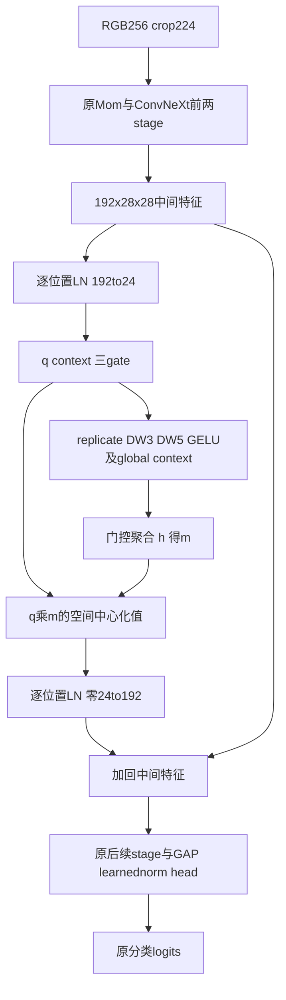

> 单图数值核验已有结果后修正：使用predict_module_stable.py，见NUMERICAL_USAGE_CORRECTION_ZH.md。原默认CLI曾超出1e-4；原失败记录和启动包保留。

# CLE中间层聚焦对比：结构、实际开训与使用

这是实际训练快照。source/config/12直接比较均事前冻结；本说明在实际开训后生成，不伪称效果确认。原CNNMom继续保留，本轮在第二stage中间特征加入互补上下文变换。最终2–3网络设计组合累计相对固定B0提升1.5个百分点，单点不要求各自+1.5；成熟Focal模块或组合不自动创新。



## 冻结结构与训练协议

快照2026-10-25T13:40:48.270062+08:00；config SHA 39fe542f23915dd7032b59f1244c5851e634e05e842945e98b918c0e10b946e0；完成0/15。
# 中间层聚焦对比调制：无CLE图像CPU原型

原CNN方向矩M继续保留。SAL完整15模型与12直接控制已完成；内容注意力候选相对M的single/C4三seed平均差均负、条件区间均负，其余控制没有构成该候选新增贡献。结果与全部阴性保留，不泛化否定全部内容建模。最终+1.5个百分点是2–3个互补网络设计组合相对固定B0的累计目标，不要求单点各自达到1.5。

本次假设是让空间上下文直接改变中间特征，再由原后续网络处理这些特征。插入ConvNeXt第二stage末尾（encoder[0][3]后，下一下采样之前），224输入对应192×28×28。保持原stem Mom、原全部特征层对象和参数、GAP/learned norm/head；新的特征残差不增加末层logit读出。

公式：逐位置无仿射channel LN1e-5→无bias192→24投影。投影经1×1分出query q、context z及三个无softmax门控g（f和h均无bias，以去掉中心化取消的常数调制及全局门控bias）。z依次经3×3与5×5深度卷积和GELU，形成短/长上下文；最后一级空间均值再GELU形成全局上下文。按三个位置门控聚合，1×1通道映射得m。候选使用q×(m−空间均值m)，逐位置无仿射24通道LN1e-5→零且无bias的24→192投影，再加回原特征。

五arm：mom_focalcontrast累计；focalcontrast_only真去18528Mom；mom_focalraw不中心化m、保留成熟Focal乘法核；mom_misaligned对中心化m的784位置作固定default_rng(20261025)置换后与未动q相乘，保持各自边缘分布但改变配对；mom_additive改乘法为q+(m−mean(m))，同参数但交互函数不同。五arm均新增11832参数；每图逻辑新增18552576 FLOPs（原224空间28×28），不将参数相同视为完全相同有效表达容量。nominal累计27852795参数/9.130393344G，去M27834267/8.928083712G；须CPU完整真实模型计数验证。mom_only/plain仅初始化参照，原Mom/B0有效三seed不重训。

成熟来源：NeurIPS2022 Focal Modulation Networks，https://papers.neurips.cc/paper_files/paper/2022/file/1b08f585b0171b74d1401a5195e986f1-Paper-Conference.pdf ；作者官方https://github.com/microsoft/FocalNet/blob/main/classification/focalnet.py 。官方代码与Microsoft MIT LICENSE字节保留；仅受限AST调用FocalModulation.forward、最后proj设Identity以比较其投影前调制核，未执行整网、训练入口或第三方导入。官方零padding核心与本实现raw核心的零padding模式做完整输出/输入及参数梯度oracle。正式候选深度卷积采用replicate padding，属于明确适配，不把与官方零padding不同的边界行为说成完全复现。共享模块库只读参考，未修改其文件。

此处的rank压缩、replicate边界、中间特征零残差、调制器中心化和无仿射LN均是适配。成熟Focal调制与M组合不自动是SCI创新。中心化m的空间均值为0，不代表q×m或最终残差空间均值为0。常数空间输入下contrast/misaligned的归一化前描述应为0（浮点容差）；raw/additive不具有该约束。replicate边界与任意已学习卷积核不保证旋转或平移等变，更不证明病灶定位、医学结构或稳健性。全局均值分支仍存在；没有声称仅局部。固定错配置换破坏规则邻接。

CPU只用随机合成及公开ImageNet起点，不读取CLE train/val/test图。先冻结源/config，再进行独立NumPy线性/显式replicate卷积/GELU/门控/中心化/LN oracle、doublegradcheck、退化矩形与常数有限、批独立、同完整通道边缘分布异空间布局反例、两合成更新；三seed×七完整公开224起点的logit/RNG/原参数ID应严格一致。零up使up首步梯度正，down/f/h/两DW首步0、第二步正；M首步梯度另检。初始零输出不代表上游已首步训练。

逻辑2FLOP/MAC包含全部新1×1/深度卷积和原三额外方向卷积；不计LN/GELU/中心化/逐元素门控/replicate padding/访存。CPU通过后仍须新目录正式冻结累计/去一/成熟控制，原Q/M A224 CE/60epoch同recipe、实际Mom/B0六完整427val概率严格重建、CUDA32两有限更新和分层梯度、白名单/缓存/实际吞吐/显存余量预检通过后才能正式开训。

train训练→val最早最佳选权重→test→下一设计；test均为自适应内部开发，历史查看且AC构建用其标签，患者bootstrap只为条件区间，不校正选择偏差，不称独立泛化或外部验证。整体active，不保证提点、新颖或录用。


## 正式15模型事前注册

5arm×45/46/47全部60epoch/batch32，原Q/M A224同公开ImageNet/seed head、CE，encoder1e-5、新模块/head1e-4、AdamW.05/cosine0/clip1/AMP/stochasticdepth.1，HV翻转/15度旋转/随机224、workers2/thread1。原Mom/B0有效3seed复用不重训，固定B0/标签/等级/清单/患者split/采样不改。

预注册mom_focalcontrast对原Mom/focalcontrast_only/mom_focalraw/mom_misaligned/mom_additive/B0两mode12整数Fraction比较，41患者20k条件CI，另保留原Mom/ECA/aug和同C4 B0/DINO/Swin强参照。3/200只是保留的历史数值审计，最终2–3网络设计组合累计目标；单点保留看相对父模型新增贡献、seed稳定性、条件不确定性和成本，可信小增量可保留。C4不作为第二/第三网络设计。不给成熟Focal模块或组合自动贴创新结论。

先正式CPU及CUDA32各arm两有限更新：up首步正、down/core首步0第二步正，Mom首步正/drop真去18528；中间模块全部headlr组。注意AdamW权重衰减可能在零梯度首步改变上游权重，不把首步无学习梯度说成绝对权重不变。原M3实际权重mom_only严格加载+B0三共六完整427val概率误差0，缓存SHA/test训练拒绝/2077索引/每完整目标实测吞吐/6GiB余量/97%最小有效并发全过后才开训。三seed全部60epoch/val最早最佳登记实际weight后test，独立427val576test×4两路线审计。所有阴性保留，原Mom保留，普通阴性不自停整体。

## 正式CPU和CUDA结果

原型逐字复制、原参数对象/公开logit/RNG/有限反向与真去Mom通过。正式CPU及真实CUDA batch32各arm两次有限更新：midstage.up首步正；down/core f/h/两个DW首步严格0、第二步正；保留Mom首步正。中间模块均headlr组。原Mom与固定B0六完整427val概率重建全部严格0；缓存SHA、2077白名单、训练加载拒绝test通过，预检test推理0。

|arm|参数|逻辑GFLOPs|
|---|---:|---:|
|plain|27822435|8.909531136|
|mom_only|27840963|9.111840768|
|mom_focalcontrast|27852795|9.130393344|
|focalcontrast_only|27834267|8.928083712|
|mom_focalraw|27852795|9.130393344|
|mom_misaligned|27852795|9.130393344|
|mom_additive|27852795|9.130393344|

逻辑2FLOP/MAC计全部新1×1/深度卷积与原三额外旋转卷积，排除LN/GELU/中心化/逐元素门控/replicate padding/访存。五新arm均新增11832参数，交互函数不同不等于完全匹配有效表达容量。

|arm|1并发图秒|2并发总图秒|4并发总图秒|cap|
|---|---:|---:|---:|---:|
|mom_focalcontrast|861.56|835.63|838.13|1|
|focalcontrast_only|1049.07|1037.59|1048.58|1|
|mom_focalraw|862.65|834.50|838.33|1|
|mom_misaligned|861.77|832.29|832.22|1|
|mom_additive|863.73|836.13|837.89|1|

采用实测最佳97%内最小并发及6GiB余量。cap非实际最大并发；PID/PPID/launch连续记录。此快照最近7行仅短片段，不外推全轮时间加权或空队列设计阶段满载。

## 使用

只使用真实完成且SHA核对的权重；管理器已运行，不重复启动。

```bash
cd /home/login/data/cle/auto/GPT
/home/login/miniconda3/envs/sunfuxiang/bin/python experiments/ac_midstage_focal_structure_window01/predict_module_stable.py --arm mom_focalcontrast --seed 45 --image /absolute/path/image.png --views single --output /absolute/path/prediction.json
```

RGB原图双线性resize256/center224/ImageNet归一，类别0/1/2、恶性1。C4四旋转概率均值非三seed集成。weights/ac_midstage_focal_structure_window01/mfc_<arm>_s<seed>/model_best.pth为实际路径；固定首val2386真实CLI对原batch32概率由独立helper在首权重完成后核验，通过后才称使用核验完成。

此为成熟Microsoft FocalNet调制核适配，不是官方整网复现或临床定位保证；无提点/SCI新颖/录用保证。全部test仍自适应内部开发，条件CI不校正选择偏差，非独立泛化或外部验证；整体active。
