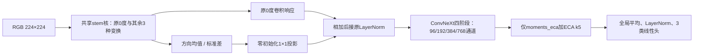

# 方向矩细化轮：结构与复现

本轮保持固定B0和原A–C清单。12个新模型均从相同公开ConvNeXt-Tiny权重、同seed三类头开始；工作结构只是原M轮发现的方向矩信号，不是替换固定baseline。原B0、完整方向矩、ECA、普通旋转增强的有效三seed不重复训练。



mean_only把均值重复拼接，random_moments将真实旋转替换为固定空间排列；二者与完整结构均增加18528参数、计入9.111840768逻辑GFLOPs/图。moments_eca额外只增加5参数；aug_moments保留完整结构，在train增加原已冻结的独立RNG随机四分之一周旋转。各项计算量、实际显存/吞吐见preflight与profile，不能把FLOPs计数当实际耗时。

CPU和CUDA预检均通过：同public/ECA初始logits完全一致、构造RNG保留、真实batch32两次AMP有限更新、新参数和encoder梯度、优化器覆盖、固定B0和原工作moments共6个checkpoint完整427图val概率逐位重建。所有正式epoch仍2077个唯一允许索引。

mean_only前三seed目前比原moments单视图平均低0.8398百分点、三个方向一致，患者条件区间不含0；random_moments单视图差仍不确定，在相同C4下低0.5227百分点、区间不含0。这里只陈述已经完成的配对证据；普通增强和ECA的完整增量对照仍须按全部三seed及区间评价，不提前认定创新。最新值见mechanism_comparisons.json。

当前入口与状态：

```bash
cd /home/login/data/cle/auto/GPT
cat experiments/ac_moment_refinement_window01/bootstrap_identity.json
cat experiments/ac_moment_refinement_window01/manager_entry_identity_v2.json
cat experiments/ac_moment_refinement_window01/status.json
```

确认同身份进程和worker已终止后才能继续启动以下入口；不要重复启动存活研究：

```bash
/home/login/miniconda3/envs/sunfuxiang/bin/python \
  experiments/ac_moment_refinement_window01/bootstrap_module_structure.py
```

真实完成的某个新模型可用：

```bash
/home/login/miniconda3/envs/sunfuxiang/bin/python \
  experiments/ac_moment_refinement_window01/predict_module_model.py \
  --arm mean_only --seed 45 --image /absolute/path/image.png \
  --views single --output /absolute/path/prediction.json
```

arm支持mean_only/random_moments/moments_eca/aug_moments；代码检查完整训练、val选择签名和checkpoint SHA，未完成不会返回随机权重。使用mean_only只是复现已完成控制，不是推荐它优于完整网络。每seed为单模型，C4为每模型四次前向，三seed报告是均值而非集成。

运行观测的原采样器在status首次建立前退出，原版/日志保留；runtime_sampler_revision_v2及连续采样v2已修复等待时序。正式训练不受影响，source/config/recipe不改。最初区间有manager资源/每epoch日志，不能虚构缺失的独立连续记录；实际v2身份和日志用于后续核验。

test按用户要求参与结构开发，历史test与A–C构建标签依赖均披露。条件bootstrap不校正选择偏差，独立审计仅指计算复核。整体研究继续，尚不能保证数值达标或SCI新颖/录用。
