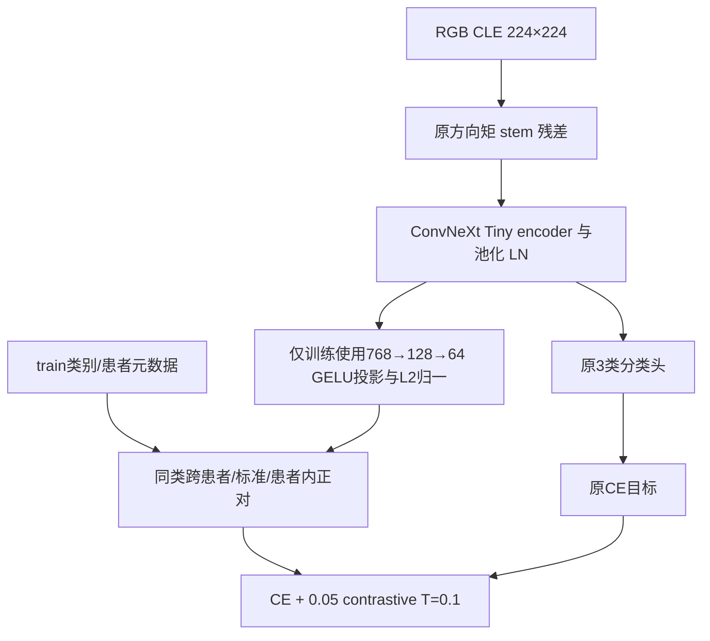

# CLE患者条件表征：实际开训与使用

原方向矩继续保留。局部几何12模型已终态独立审计，全部未达严格门槛，几何不作为确认组件。新轮已先冻结机制/配置/任务和数值检查，再以完整辅助训练目标实测吞吐，现已实际启动12项配对正式训练；本文件是启动快照，不能当效果结论。

快照时间2026-10-25T04:41:22.006233+08:00；config SHA 68e99795c2f3de1018a879abadd51e77db72d4a04fd483b32689398a9de770be。

## 结构与机制



推理仅encoder→分类头，不执行辅助投影或需要患者ID。假设跨患者同类对齐可减少病例特征依赖，反机制是跨患者过度收缩可能丢失个体信息，用同患者同类对照检验；成熟标准SupCon控制改mask是否必要，cross_only去方向矩检验互补。此为可被否证的CLE适配，患者对比与SupCon已有先验，不预先宣称新颖。

|arm|方向矩|正对规则|总训练参数|推理前向参数|单视图逻辑GFLOPs|
|---|---|---|---:|---:|---:|
|mom_cross|是|同类不同患者|27,947,459|27,840,963|9.111841|
|cross_only|否|同类不同患者|27,928,931|27,822,435|8.909531|
|mom_supcon|是|标准同类全部|27,947,459|27,840,963|9.111841|
|mom_within|是|同类同患者|27,947,459|27,840,963|9.111841|

投影额外106496参数，训练参与反向，保存于真实checkpoint，但推理前向不调用；逻辑推理成本不含训练MLP/32×32相似矩阵，也不含归一化/逐元素/访存，实际全目标吞吐另报。C4每模型四次前向，三seed均值不是集成。

## 训练语义与数值证据

train2077/182患者，共267患者×类别组合，患者可有多标签。同类被排除对不成为伪负；异类同患者仍为负。cross/within分母为相应正对和全部异类，空正对anchor贡献0、全anchor均值。只一个图像增强视图，原随机batch32、2077索引每epoch一次，不额外重采样/筛图，不改标签等级split。within有效anchor可能稀疏，所有epoch输出ce_loss、contrastive_loss、valid_anchor_fraction、mean_positive_pairs和实际索引SHA，不能隐瞒。

原型CPU通过独立NumPy三mask公式、官方标准单视图SupCon输出/输入梯度、double gradcheck、空正对/单样本/常量有限及公开Tiny-Mom初始化/RNG/原参数ID/投影反向。正式CPU六类公共初始logit逐位一致、有限梯度、参数/预算；独立引擎AST只改worker目标回调/日志，其余函数一致。CUDA真实batch32所有四arm两步有限、投影梯度非零，原B0/Mom六个完整427val概率复建最大差全0.0，物理cache SHA和test训练加载拒绝通过。预检不是CLE结构有效证据。

## 单任务与并发实测

|目标|1并发图/秒|2并发总吞吐|4并发总吞吐|所选并发|
|---|---:|---:|---:|---:|
|mom_cross|844.30|831.90|未继续（满载且无吞吐增益）|1|
|cross_only|1020.29|1027.27|1053.70|2|
|mom_supcon|840.79|832.53|839.30|1|
|mom_within|835.29|831.94|839.55|1|

实测包含CE、投影、mask与完整辅助反向。选择实测最佳97%以内的最小并发，GPU满载且吞吐无益不继续扩容，显存保留6GiB，未沿用旧6/8并发上限。cross_only选择2，其余1；每arm正式三seed，不为填硬上限制制造额外任务。

快照的最近53行采样（2026-10-25T04:39:35.188053+08:00至2026-10-25T04:41:20.525043+08:00）平均GPU 85.40%、CPU 7.81%，只表示该短时快照，包含启动，非完整训练长期统计。持续每2秒记录GPU/显存、CPU每核/总量、I/O/RAM、自身进程及DataLoader子进程，另有每epoch等待/吞吐/耗时。

## 可复现和模型使用

全部同公开ImageNet及配对seed45/46/47初始化，60epoch/batch32、原encoder1e-5、新方向矩/头/投影1e-4、AdamW.05/cosine0/clip1/AMP、原HV/rotation15，worker2/thread1。原0度val最早最高macroF1选权重。固定B0不更换，六有效参考按源码/任务/权重SHA复用。当前manager已实际运行，不重复启动bootstrap。训练入口experiments/ac_patient_alignment_structure_window01/bootstrap_module_structure.py，必须先核identity/proc与部分完成证据。

完成真实checkpoint后使用：

```bash
cd /home/login/data/cle/auto/GPT
/home/login/miniconda3/envs/sunfuxiang/bin/python experiments/ac_patient_alignment_structure_window01/predict_module_model.py --arm mom_cross --seed 45 --image /absolute/path/image.png --views single --output /absolute/path/prediction.json
```

脚本拒绝未完成或SHA不符权重，权重weights/ac_patient_alignment_structure_window01/<job>/model_best.pth，类别0/1/2，恶性1。固定首val真实权重CLI核验待首模型完成后补充，不能将尚未完成脚本准备写为已经通过。预处理RGB→256双线性→中心224→ImageNet归一，C4四旋转概率平均。

## 评价与研究边界

四arm三seed全部完成再统一独立概率重建和直接对照，报告macroF1、accuracy、恶性召回、患者等权accuracy、混淆矩阵、预算及实际权重/预测SHA。严格meanΔ>0.015、所有配对seed正、41患者条件bootstrap下界正，整数Fraction对3/200独立复算。累计对原Mom、去一、成熟SupCon、患者内反机制、固定B0提前登记，single和C4分列并保留强同预算参照。

用户明确test反馈下一结构，历史test已查看且AC构建用过其标签；所有test为自适应内部开发，bootstrap仅条件描述不校正筛选偏差，不称独立泛化/全新外部验证。等级仅模型一致性代理。成熟SupCon/患者对比已有相关先验，不称PaCL整法复现或预设SCI创新/录用。普通阴性保持记录并继续机制研究，不以几轮benchmark替代整体目标。
