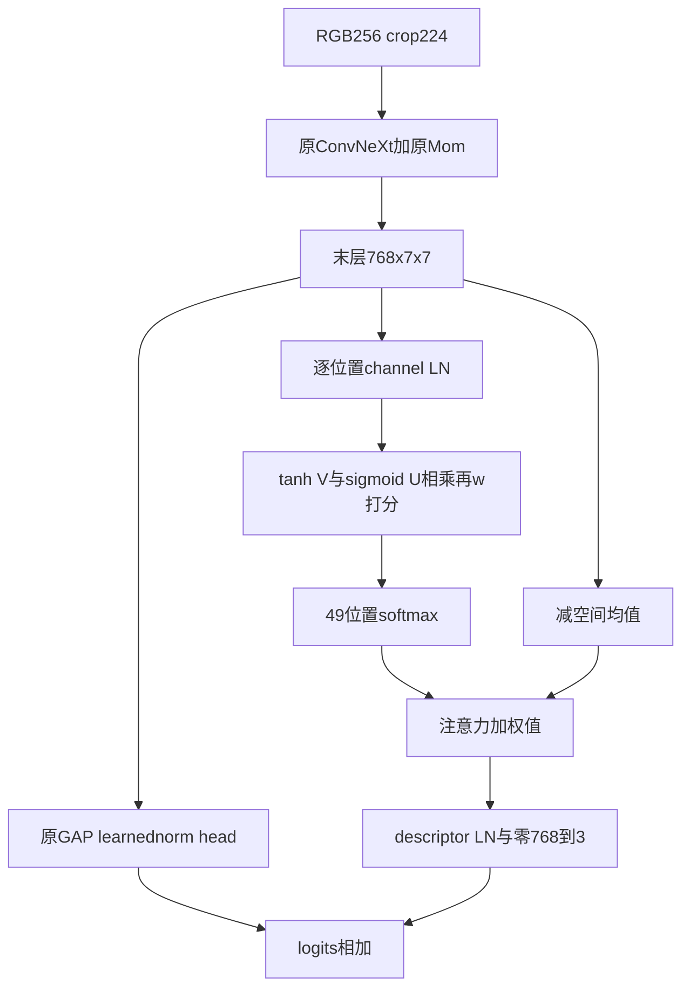

# CLE内容注意力对比：结构、实际开训与使用

这是实际训练快照。source/config/12直接比较均事前冻结；本说明在实际开训后生成，不伪称效果确认。保留原CNNMom，前轮协方差未确认对原Mom新增贡献。新分支依据末层特征内容分配权重，所有注意力/差值/归一化与组合均非自动创新。
快照2026-10-25T12:37:27.205138+08:00；config SHA 3bd06d2c1d8481d2b1cd6bdfee3c7d96d051b83854e3d3c7dcf7089c479cc7e3；完成0/15。



## 冻结结构与训练协议

# 特征内容注意力对比：无CLE图像CPU原型

原CNNMom继续保留。前一协方差15模型全轮完成；完整候选对原Mom single/C4点差均负且条件CI跨0，对通道独立置换两mode增量CI也跨0，不确认新增组件。single对diag条件CI正但seed方向混合，diag只有16有效坐标，不能倒置为对原Mom增量。不泛化否定全部联合统计。

下一互补假设是末层49个特征位置的信息贡献并不相同。原Mom刻画stem方向响应分布，新的只读出末层内容选择。保持原GAP/learned norm/head；在768×7×7特征每位置做无仿射channel LN1e-5，gated score = w[tanh(Vh)×sigmoid(Uh)]，rank16，w无bias（常数bias会在softmax取消）。softmax在49位置归一。候选d=Σ a_i(f_i−mean(f))，768维无仿射LN1e-5与零768→3分类器加原logits。无CNN外部图像/患者信息、无区域标签/筛图/重采样。它只关注特征内容，不保证病灶定位或医学解释。

五arm：mom_salience累计；salience_only真去18528Mom；mom_weightedmean用相同gated score加权原f，不减均值；mom_misaligned对权重位置作固定default_rng(20261025)49置换再与未置换value相乘，保留权重和值的各自分布而改变配对；mom_ungated去sigmoid U，只保留成熟tanh attention。前三种gated新26931参数，ungated新14627参数，后者参数更少并非容量匹配，不隐藏差异。mom_only/plain仅初始化参照，不重训原有效Mom/B0参考。此前F的field_pool按原图支持掩码加权，本次是末层可学习内容权重，保留此前阴性，不混称新原理。

成熟来源：[Ilse等2018 PMLR论文](https://proceedings.mlr.press/v80/ilse18a.html)、[官方AttentionDeepMIL](https://github.com/AMLab-Amsterdam/AttentionDeepMIL)。论文提出按实例内容学习归一权重及gated扩展。本地只适配已审阅pooling公式：加入score输入LN、去w无效bias、减GAP、descriptor LN及保留原分类路径零残差；不是原始MNIST-BAGS/病理MIL整网复现，不继承原文分类或解释性结论，不把注意力/差值/LN/残差或Mom组合称创新。

官方model.py与MIT LICENSE原字节保留，Gitblob分别e99adc74d63240c637f3a1ec3174c4a2d9f1aa26、58ed84464a359db312c3da36f040bfeba8f8572d，作者2018 Maximilian Ilse/Jakub Tomczak归属保留。仅受限AST提取GatedAttention.forward的A_V/A_U/A/Z六赋值做输出、输入及全部score参数梯度oracle，不执行模型训练入口。原型算子按公式本地实现。

所有CLE训练/val/test图0。CPU做独立NumPy线性/门控/softmax/加权和/LN、doublegradcheck、常数/退化矩形有限、联合位置排列不变（错配控制除外）、批独立、同GAP不同内容反例、两合成SGD更新及三seed×七完整公开224起点logit/RNG/原参数对象一致。零分类器首步使V/U/w梯度0；分类器首步正，第二步V/U/w正，正式CUDA也须真实batch32检查。softmax和LN会改变尺度，没有稳健性保证；联合位置不变不等于整个CNN等变，错配控制固定置换破坏此性质。

逻辑2FLOP/MAC包括新Linear、attention加权pooling BMM和原三额外旋转conv；不计LN/softmax/tanh/sigmoid/中心化/逐元素/访存，实际完整目标吞吐另测。通过CPU后才可新目录正式冻结5arm×3、原Q/M A224 CE/60epoch同recipe、六完整427val真实权重重建/CUDA32两更新/profile通过后开训。不能将CPU通过说成CLE增益。train→val最早最佳→test→下一设计；全部test自适应内部开发，条件CI不校正选择偏差。整体active，不保证提点、SCI新颖或录用。


## 正式15模型事前注册

5arm×45/46/47全部60epoch/batch32，原Q/M A224相同公开ImageNet和seed head、原CE；encoder1e-5，新模块/head1e-4，AdamW.05、cosine0/clip1/AMP、stochasticdepth.1，HV翻转/15度旋转/随机224裁剪、workers2/thread1；参考原Mom/B0有效三seed复用，不更换/削弱/少给调参预算。原型与原Mom逐字复制，库调用本原型完整MAC counter。

固定AC train2077/182患者、val427/39、test576/41、恶性1，患者可多标签；标签/等级/阈值/清单/患者互斥split/采样不改。物理3595缓存非训练3595；每epoch2077唯一索引SHA e8fe76bbcf6d8faf8dcb6f38a148341ffe81d10ac0cdc3e4dc38e9f8ccafd691。全部60epoch原0度val最早最大macroF1选权重，三seed完成登记实际checkpoint后再test四角度。独立直接A物理缓存固定索引与T TestData A路线完整427val/576test×4概率审计。

预注册mom_salience对原Mom/salience_only/mom_weightedmean/mom_misaligned/mom_ungated/B0两mode12直接整数Fraction控制；41患者20k条件CI，主比较保留原Mom/ECA/aug及同C4 B0/DINO/Swin。严格门槛为平均差>3/200、三seed全正、条件CI下界>0；自适应内部test，区间不校正选择偏差，非独立泛化/外部验证。去Mom支持不能倒置成新分支增量。

正式CPU、真实CUDA32两有限更新/全梯度有限、分类器首步正和V/U/w首步0第二步正/原Mom首步正/去Mom真移18528、原Mom三actual权重经mom_only严格load加B0共六完整427val概率严格0，全部缓存SHA/训练拒绝test/2077索引和每完整arm实测吞吐/6GiB余量/97%最小并发全过才开训。所有有效模型/阴性保留，普通阴性不停止整体。

## 正式CPU和CUDA结果

原型逐字复制、原参数对象/公开logit/RNG/有限反向与真去Mom通过。真实CUDA batch32各arm两次有限更新：新分类器首步正；V/U/w首步严格0、第二步正，ungated无U；保留Mom首步正。原Mom与固定B0六完整427val概率重建全部严格0；缓存SHA、2077白名单、训练加载拒绝test通过，预检test推理0。

|arm|参数|逻辑GFLOPs|
|---|---:|---:|
|plain|27822435|8.909531136|
|mom_only|27840963|9.111840768|
|mom_salience|27867894|9.114330656|
|salience_only|27849366|8.912021024|
|mom_weightedmean|27867894|9.114330656|
|mom_misaligned|27867894|9.114330656|
|mom_ungated|27855590|9.113126432|

逻辑2FLOP/MAC计新score/classifier Linear、attention加权pooling BMM与原三额外旋转卷积，排除LN/softmax/tanh/sigmoid/中心化/逐元素/访存。ungated新14627比gated26931参数更少，非等容量，明确披露。

|arm|1并发图秒|2并发总图秒|4并发总图秒|cap|
|---|---:|---:|---:|---:|
|mom_salience|884.19|850.50|851.24|1|
|salience_only|1067.06|1055.72|1066.97|1|
|mom_weightedmean|872.86|844.98|849.89|1|
|mom_misaligned|875.54|848.00|850.12|1|
|mom_ungated|878.04|848.80|850.69|1|

采用实测最佳97%内最小并发及6GiB余量。cap非实际最大并发；PID/PPID/launch连续记录。此快照最近7行仅短片段，不外推全轮时间加权或空队列设计阶段满载。

## 使用

只使用真实完成且SHA核对的权重；管理器已运行，不重复启动。

```bash
cd /home/login/data/cle/auto/GPT
/home/login/miniconda3/envs/sunfuxiang/bin/python experiments/ac_salience_contrast_structure_window01/predict_module_model.py --arm mom_salience --seed 45 --image /absolute/path/image.png --views single --output /absolute/path/prediction.json
```

RGB原图双线性resize256/center224/ImageNet归一，类别0/1/2、恶性1。C4四旋转概率均值非三seed集成。weights/ac_salience_contrast_structure_window01/sal_<arm>_s<seed>/model_best.pth为实际路径；固定首val2386真实CLI对原batch32概率由独立helper在首权重完成后核验，通过后才称使用核验完成。

此为成熟Ilse2018注意力pooling适配，不是官方整网复现或临床定位保证；无提点/SCI新颖/录用保证。全部test仍自适应内部开发，条件CI不校正选择偏差，非独立泛化或外部验证；整体active。
