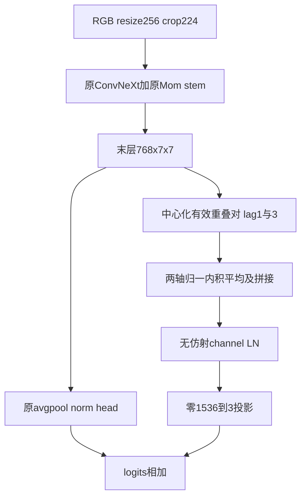

# CLE空间间隔关联：结构、实际开训与使用

此为真实开训快照，不能判断三seed效果。原CNNMom保留，ODD全轮未确认末层奇统计增量；本轮用空间间隔关系作互补假设。
快照2026-10-25T10:42:11.328107+08:00；config SHA fd59cdac79dfcaa274e2e2232f58c7c22463e2eb674a19468b59e35ed44557d5。



## 冻结结构与训练协议

# 两间隔空间关联：无CLE图像CPU原型

ODD全15模型的10个固定B0数值门槛均false；候选对原Mom未确认累计增量，对同容量raw3/std/even控制也未确认优势。因此不把末层有界奇统计或这些控制带成已确认组件。原CNN方向矩工作机制保留。本轮假设：ODD类空间排列不变描述会丢失邻接关系，最后特征图的两种空间间隔关联可能补充原stem方向均值/标准差。此为完整结果后的新假设，非事前ODD假设或临床因果解释。

设末层B×768×7×7特征按每图每通道全空间均值中心化c。对间隔l=1、3，分别取不环绕、不padding的水平与垂直有效重叠对a,b。候选每轴rho=mean(ab)/(sqrt(mean(a²)+1e−6)*sqrt(mean(b²)+1e−6))，两可用轴等权平均，拼接两间隔共1536维，经无仿射channel LN eps1e−5和零1536→3投影加原logits。原avgpool/learned norm/head完整保留，新4611参数；保留Mom另18528参数。没有学习前即改变公开logit的池化替换，没有CLE checkpoint热启动。

五arm：mom_lag原Mom加完整描述；lag_only真去18528Mom；mom_permuted对原7×7特征按固定种子20261025的49位置置换后计算同一描述，保持每通道全部边缘分布/空间矩，破坏邻接；mom_duplicate把同一lag1重复两份，去掉第二空间间隔但保留1536维/同参数，重复只优化重参数化、无新描述能力；mom_acf用同有效对sum(ab)/(sum_all(c²)+1e−6*HW)这一成熟全能量ACF归一控制，仍水平/垂直平均并拼接两个间隔。所有控制同无仿射LN及4611零投影。mom_only/plain仅原型初始化参照。

候选是全局中心化后的重叠向量归一内积，不是重新逐对中心化的Pearson相关，也不等于NIST全能量归一。LN前rho在[-1,1]，LN后没有该界。有限eps仅近似正比例缩放不变；标准化并不自动稳健。两轴平均对未置换的描述在90度旋转/反射下保持；固定置换控制不具此性质，普通CNN整网也不保证等变。不声称病灶定位、真实临床拓扑、某像素/病理尺度或方向被保留；平均会丢失绝对位置与方向。lag3只有少量重叠对，估计方差可能较高，需明确消融。

成熟来源：[NIST autocorrelation](https://itl.nist.gov/div898/handbook/eda/section3/eda35c.htm)给出延迟乘积与全中心能量归一，mom_acf是该一维公式在两个空间轴的明确适配，非原文2D医学方法；[GNPP作者页面/摘要](https://arxiv.org/abs/1607.06514)已研究神经响应空间共现，证明空间关系作为方向并非新概念。这里没有复现GNPP算法或声称其作者代码验证，未复制第三方实现。零残差、LN、自相关及组合不自动创新。NumPy零padding FFT只作为线性空间相关分子的独立数值oracle，不是学习时傅里叶模块，也不同于POWER的四方向DFT统计。

本阶段只做NumPy显式有效对/零padding FFT/成熟ACF公式、同边缘分布异布局与同lag1异lag3反例、双精度gradcheck/退化有限/批独立及原公开初始化检查，CLE图/训练/val/test图均0。CPU通过后仍需独立正式注册、完整CUDA batch32与六完整427val概率重建、缓存隔离白名单和吞吐profile。正式若实施，仍是原AC不改标签/等级/split/采样，原M同recipe CE/60epoch/三seed，val选权重→test反馈下一设计，累计/去一/错序/去第二间隔/成熟ACF对照。整体active，不保证提点/SCI新颖/录用，所有test为自适应内部开发，患者bootstrap只为未校正选择偏差的条件区间。


## 正式十五模型注册

五arm×45/46/47各60epoch/batch32，原Q/M A224同recipe：公开ImageNet及相同seed head，原CE，encoder1e-5、新模块/head1e-4、AdamW.05、cosine0/clip1/AMP、stochasticdepth.1、HV翻转/15度旋转/随机224裁剪、workers2/thread1。原CNNMom与固定B0有效三seed复用，不更换或削弱基线。CPU原型源码逐字复制；原公开logit零残差相等不代替正式真实权重严格加载和六完整427val概率重建。

固定AC train2077/182患者、val427/39、test576/41，恶性1，患者可多标签。标签/等级/阈值/清单/患者互斥split与采样不改。物理3595缓存不等于训练3595。每epoch2077唯一白名单SHA e8fe76bbcf6d8faf8dcb6f38a148341ffe81d10ac0cdc3e4dc38e9f8ccafd691。全部60epoch的原0度val最早最大macroF1选权重，每组三seed完成后才登记实际checkpoint并test四角度；独立直接像素与T TestData A路线完整427val和576test概率审计。

直接预注册mom_lag对原Mom/lag_only/mom_permuted/mom_duplicate/mom_acf/固定B0两mode共12比较，三配对seed、整数Fraction及41患者20k条件区间；强同C4 B0/DINO与成熟ECA/aug仍在主比较保留。可靠数值门槛为平均差严格>3/200、三seed全正及条件区间下界>0。所有test为用户授权自适应内部开发，CI不校正选择偏差，非独立泛化或外部验证。不把成熟ACF/主干/C4预算收益归因新结构。所有有效模型/阴性均保留；一般阴性不停止整体研究。

正式CPU、CUDA真实batch32两次有限更新/Mom与projection首grad、六完整427概率严格0、缓存SHA/训练拒绝test/2077白名单、每完整arm实测吞吐及6GiB余量/97%规则全过才开训。CPU不宣称实训。整体active，不保证提点、SCI新颖或录用。

## 正式CPU和CUDA结果

正式CPU逐字复制原型、真去Mom、原参数对象/公开logit/RNG/有限反向通过；真实CUDA batch32各arm两次有限更新、projection与保留Mom首步梯度正，原Mom与固定B0共六完整427val概率重建严格0；缓存SHA、2077白名单和训练加载拒绝test通过。预检test推理0。

|arm|参数|逻辑GFLOPs|
|---|---:|---:|
|plain|27822435|8.909531136|
|mom_only|27840963|9.111840768|
|mom_lag|27845574|9.111849984|
|lag_only|27827046|8.909540352|
|mom_permuted|27845574|9.111849984|
|mom_duplicate|27845574|9.111849984|
|mom_acf|27845574|9.111849984|

逻辑2FLOP/MAC含三额外旋转卷积/新Linear，不含重叠统计/LN/逐元素/访存；实际完整目标吞吐另测。

|arm|1并发图秒|2并发总图秒|4并发总图秒|cap|
|---|---:|---:|---:|---:|
|mom_lag|865.44|843.53|844.72|1|
|lag_only|1048.71|1045.50|1053.16|1|
|mom_permuted|866.64|838.14|843.37|1|
|mom_duplicate|867.72|837.82|842.80|1|
|mom_acf|873.83|845.79|849.87|1|

选择实测最佳97%内最小并发，保留6GiB余量。cap不等于真实并发，每arm仅3seed。实际PID/PPID/launch和GPU/CPU每核/IO/RAM连续采样；此快照7行GPU平均只是启动前缀，不外推全轮或空队列设计阶段。

## 使用

只使用真实完成且SHA核对的权重；管理器已运行，勿重复启动。

```bash
cd /home/login/data/cle/auto/GPT
/home/login/miniconda3/envs/sunfuxiang/bin/python experiments/ac_spatial_lag_structure_window01/predict_module_model.py --arm mom_lag --seed 45 --image /absolute/path/image.png --views single --output /absolute/path/prediction.json
```

RGB原图双线性resize256/中心224/ImageNet归一，类别0/1/2、恶性1。C4为四旋转概率均值，非三seed集成。weights/ac_spatial_lag_structure_window01/lag_<arm>_s<seed>/model_best.pth为实际权重路径。固定首val2386真实CLI对原batch32概率另行核验，通过helper后才称使用核验完成。

全部test为自适应内部开发，CI不校正选择偏差，非独立泛化或临床验证；没有新颖或录用保证。整体研究active。
