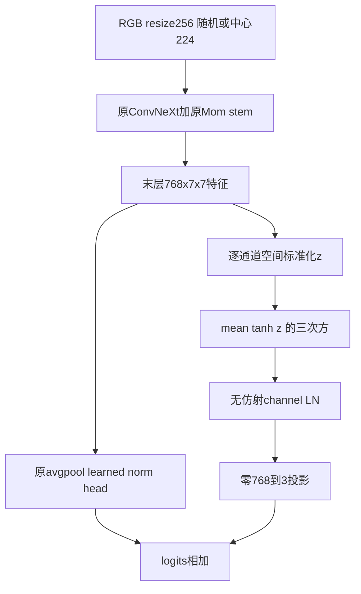

# CLE末层空间奇统计：结构、实际开训与使用

MERGE全轮完成、同主干视图匹配区间未确认新组件；保留原CNN方向矩工作机制，新增一个末层空间分布描述。五arm×45/46/47共15模型，所有seed和阴性保留。启动凭据只能证明实训已开始，不证明效果。

快照：2026-10-25T09:45:27.129856+08:00；config SHA 30cfdc92603d4cafd715602aba5516e34f3df0f82a93684ae7ab1f81f19224f7。

## 数据流



z=(x−空间μ)/sqrt(空间v+1e−6)，d=mean(tanh(z)^3)，再无仿射channel LN eps1e−5。原avgpool/learned norm/head对象完整保留。mom_odd累计；odd_only真去18528方向矩；mom_raw3相同z三阶矩；mom_std相同空间标准差减.001；mom_even相同tanh偶二阶去符号。四统计同LN/同2307参数零投影，原公开logit/RNG/原参数ID一致，未热启动CLE权重。

|arm|参数|逻辑GFLOPs|
|---|---:|---:|
|plain|27822435|8.909531136|
|mom_only|27840963|9.111840768|
|mom_odd|27843270|9.111845376|
|odd_only|27824742|8.909535744|
|mom_raw3|27843270|9.111845376|
|mom_std|27843270|9.111845376|
|mom_even|27843270|9.111845376|

逻辑2FLOP/MAC含三额外旋转卷积和新Linear，不含统计/tanh/LN/逐元素/访存；实际吞吐另测。原Mom/B0的有效三seed复用，固定B0预算与选择规则不改；成熟C4参照同时保留。

## 训练、审计和边界

固定AC train2077/182患者、val427/39、test576/41，恶性1、患者可多标签。原标签/等级/阈值/清单/split/采样不变。物理3595缓存不是训练3595；每epoch2077唯一索引SHA e8fe76bbcf6d8faf8dcb6f38a148341ffe81d10ac0cdc3e4dc38e9f8ccafd691。原Q/M A224公开ImageNet，stochastic depth .1，60epoch/batch32，encoder1e-5、新模块/head1e-4，AdamW.05/cosine0/clip1/AMP、HV翻转/rotation15/randomcrop224、workers2/thread1。

原0度val最早最高macroF1选权重；三seed全部完成后注册实际checkpoint，再读完整576test四角度，独立直接像素与冻结T TestData A两路线重建。直接控制mom_odd对原Mom/odd_only/raw3/std/even/B0两mode，整数Fraction严格>3/200、三seed方向及41患者20k条件CI，强同预算参照不能省略。test按用户授权反馈下一设计，历史查看且AC构建用标签；全部自适应内部开发，CI不校正选择偏差，不是独立泛化或外部验证。

正式CPU七变体公开起点/有限反向/真去Mom/参数预算通过；原型NumPy、反例、gradcheck、退化有限通过。CUDA真实batch32两次有限更新及新投影/Mom梯度非零、原Mom与B0六完整427val概率误差均0、训练加载拒绝test、缓存SHA通过。不是仅凭结构名推断兼容。

[Spatial Moment Pooling作者论文](https://arxiv.org/abs/2209.14583)已有高阶空间矩和LN。raw3只是受控接口适配，不是作者多阶拼接/IQA完整复现，也未确认作者代码。tanh、矩、LN、零残差及组合不自动新颖。d在LN前[-1,1]、LN后无此界；非Pearson偏度、不保证稳健影响函数、病灶定位或整网等变。

## 真实吞吐选择

|arm|1并发图秒|2并发总图秒|4并发总图秒|cap|
|---|---:|---:|---:|---:|
|mom_odd|878.53|845.82|850.93|1|
|odd_only|1066.94|1050.51|未继续|1|
|mom_raw3|874.86|845.04|848.98|1|
|mom_std|880.44|850.14|851.86|1|
|mom_even|872.97|843.54|849.38|1|

选择实测最佳97%内最小并发，保留6GiB余量。每arm仅三seed，cap不等于真实并发；资源连续保留实际PID/PPID/launch、GPU/CPU每核/IO/RAM。此处启动38行平均GPU仅短快照，不外推全轮，最终报告按时间加权保留低GPU区间。

## 使用

管理器已运行，勿重复启动。仅使用真实已完成、SHA核对的权重：

```bash
cd /home/login/data/cle/auto/GPT
/home/login/miniconda3/envs/sunfuxiang/bin/python experiments/ac_spatial_odd_moment_structure_window01/predict_module_model.py --arm mom_odd --seed 45 --image /absolute/path/image.png --views single --output /absolute/path/prediction.json
```

RGB原图resize256双线性/中心224/ImageNet归一，类别0/1/2、恶性1；C4四旋转概率均值，非三seed集成。首固定val2386真实checkpoint CLI将单独比对原batch32概率，helper通过后才称使用核验完成。权重位于weights/ac_spatial_odd_moment_structure_window01/odd_<arm>_s<seed>/model_best.pth。整体active，不保证提点、SCI新颖或录用。
