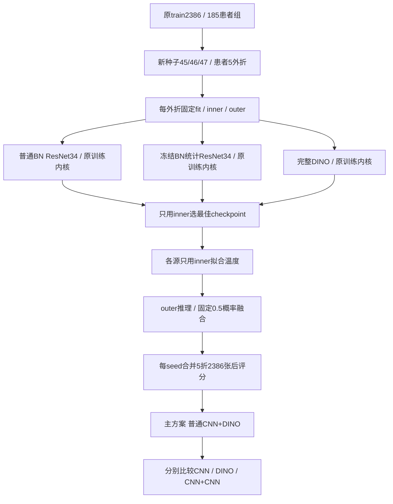

# 次方案的预注册重复

第十二阶段主门槛失败；普通CNN+DINO只是预定次方案的正信号。本阶段在看到新输出前，固定种子45/46/47及三个主要对照，尝试复核它。沿用同185患者组，因此不是外部验证。

45个新源神经模型与45个温度参数，得到6个固定单源/融合流程×3seed共18份OOF。原固定val/test不参与、无A–E筛图/权重或标签修正。完整训练与严格内层选checkpoint，温度和融合算法均不调参。

三项主要比较均需三差正、均值至少+1pt、三比较家族区间下界正。未达标就报告不稳定，不能改融合比例或切换主要对照。双模型参数和计算更高；即使重复成功，也只是设计后续CLE混合/蒸馏结构的依据，集成本身不是新颖网络贡献。
