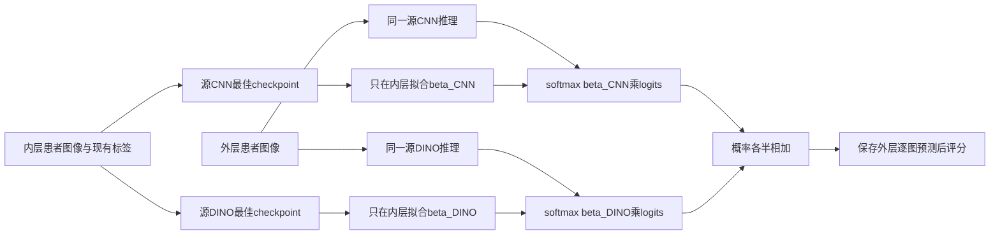

# 固定 CNN—DINO 互补诊断

本阶段不训练神经网络。每个外层折复用同一批患者划分训练出的两个源模型；只用内层患者拟合各自一个温度参数，融合比例预先固定为1:1。

外层标签不用于温度或权重拟合。内层也用于选过checkpoint，因此它不是独立校准队列，结果仍须在外层评分。beta保持正值，不改变单模型argmax，单模型F1理应与第十一阶段相同；融合是否改善必须由数据回答。

六流程为普通CNN、冻结BN CNN、完整DINO、普通CNN+DINO、冻结CNN+DINO（预定主方案）及普通CNN+冻结CNN。45个源模型、45次标量拟合、18份合并OOF，零新增神经训练。跨架构融合同时运行两个模型，参数与计算更高；同族CNN对照不代表计算严格匹配。温度缩放和等权融合都是成熟方法，此处只提供是否值得设计CLE混合网络的证据。

温度缩放参考：[Guo等，ICML2017](https://proceedings.mlr.press/v70/guo17a.html)。本实验的边界、患者划分和固定融合方式见ROUND12_PROTOCOL.md，不声称复现原论文完整协议或具有临床校准有效性。
