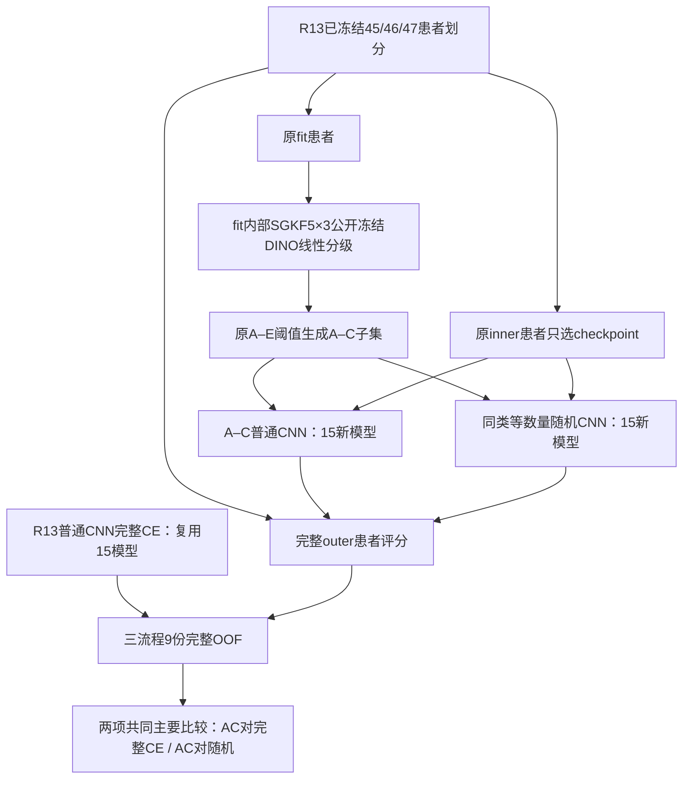

# 第十五阶段：A–C次线索的新划分复核

R14完整主/次门槛均失败，本轮不重解释旧结果。只复核A–C相对匹配随机筛选的图像身份线索。

225次凸线性分级拟合，不是225次神经训练。最多30新CNN、15复用CNN；与旧42/43/44分级头的fit集合不同。原inner/outer患者完全排除分级拟合、标准化和等级生成。原固定val/test不加载、不评分、不筛图或改标签。

3seed每项差均正、平均≥1pt、两比较家族区间[1.25,98.75]下界正，且两项同时满足才通过本轮。该两项家族只用于新输出，不能回头替换R14四项家族判据。相同185患者的内部重复不是外部临床确认。
