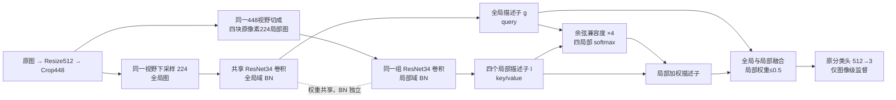

# 第四轮候选结构：同源全局—局部联合分类

尚未确认有效性或创新性。本轮同时训练同源全局、标准 448、固定融合和普通注意力对照。

四局部图覆盖完整裁剪视野，可逐位拼回原输入。全局关闭局部分支后，与同源下采样的原主干逐位一致。局部权重不代表病灶位置或人工质量等级；未给每张局部图追加病理标签。

五视图增加计算量。第四轮的主要基线使用同样 512/448 预处理，区别于此前的 256/224 基线。完整网络必须超越信息相同的固定融合与匹配注意力对照，才有新增机制的证据。
