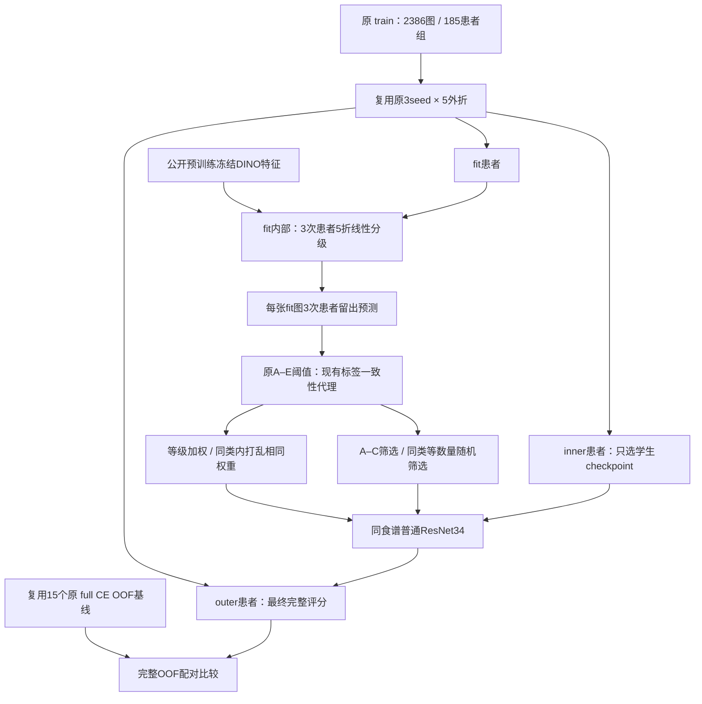

# 第十四阶段：严格嵌套的自动分级对照

inner与outer患者不进入分级头拟合、标准化或分级。outer始终完整评分，不按等级筛掉困难图。

225次凸线性分级拟合不是225次神经训练。新增学生CNN最多60个，另复用15个基线；精确相同的有效训练配置会复用模型并记录别名。

预先指定主比较：等级加权相对完整CE、相对打乱权重。次比较：A–C相对完整CE、相对同类等数量随机筛选。每个方法必须同时通过两项三种子正差、平均至少1pt、四比较家族区间下界正的标准。

这检验所定义的自动分级是否有助于患者泛化，不能把分级当临床质量金标准或证明标签错误。仍为同185患者内部研究，不是外部独立确认。
