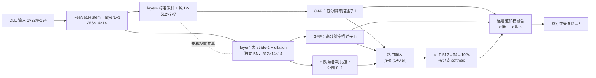

# 第三轮研究候选结构

这是未经独立确认的实验候选。普通空洞、固定融合与 SK 式匹配对照同步训练，未证明新增机制有效。

初始分支权重均为 0.5，不通过零权重旁路启用高分辨率特征。对比度不等同于病灶或图像质量。SK 式对照将路由输入改为 h+l，其余计算路径与参数相同。所有模型均使用原始三类标签，不接收等级、患者 ID 或亚型信息作为推理输入。

这是末级特征的分辨率保留，并未恢复输入缩放中已丢失的信息。双路径需要额外推理计算。具体来源、机制消融、晋级条件与局限见 ROUND3_PROTOCOL.md。
