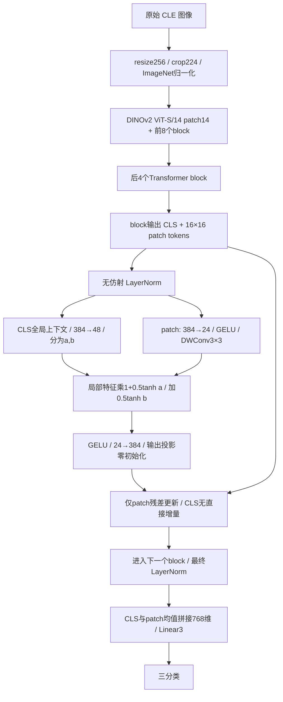

# CLETokenAdapterNet：第十轮候选与公平对照

这是尚待实验验证的候选结构。DINOv2、LoRA、局部适配器和 FiLM 都有成熟先例；本设计的价值必须由 CLE 上的完整对照与消融证实，不能把组合名称当作已证实创新。

后四个 block 都使用上述适配器。除完整微调对照外，预训练参数冻结；梯度仍能通过冻结矩阵传递。候选通过已有全局 CLS 调节局部纹理，不声称高频代表病灶或定位了病灶。均值上下文版本以 patch 均值替换 CLS，其余参数、形状和算子预算相同。

| 方案 | 可训练参数 | 计数 FLOPs / 单图224 | 真实 AMP batch32 峰值分配显存 |
| --- | ---: | ---: | ---: |
| 冻结编码器，仅训练线性头 | 2,307 | 12.247G | 0.224GB |
| 完整微调 | 21,631,107 | 12.247G | 1.989GB |
| 后四层 Q/V LoRA rank24 | 149,763 | 12.323G | 0.735GB |
| 普通局部适配器 rank48 | 153,411 | 12.324G | 0.500GB |
| CLS上下文局部适配器 rank24 | 152,547 | 12.285G | 0.497GB |
| patch均值上下文局部适配器 rank24 | 152,547 | 12.285G | 0.495GB |

FLOPs 计数范围为 Conv/Linear 和注意力 QK/AV，2 FLOPs/MAC；没有计入激活、归一化、softmax、数据移动，不代表真实延迟完全匹配。峰值为单进程预检查的两步训练实测，不包括其他进程和 CUDA 驱动保留显存。

完整微调 encoder 学习率1e-5，头1e-4；其他头和适配器1e-4，全部60epoch。原全量train2386与完整val538；不使用等级筛图或测试反馈。主要检验候选能否超过冻结、完整微调、LoRA、普通局部与均值上下文五个预定对照。初始输出逐位相同、两步后梯度、冻结权重及独立公式参考已通过；这些检查只确认实现有效，尚不说明分类收益。
