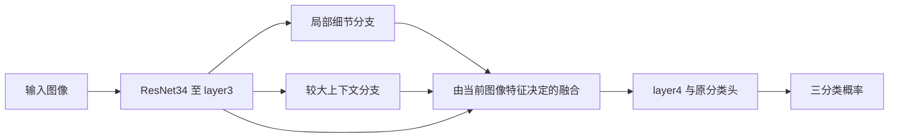

# CLE研究流程与结构草案

日期：2026-10-24。状态：模块静态抽查与文献核验已完成；网络为待验证草案，不是已完成模型或已确认创新。当前患者级A–E及三组数据实验继续按既有冻结协议运行。本文件不改动其脚本、划分、阈值或测试规则。

## 1. 研究目标与前提

目标是建立在不同可靠性图像上均有清楚适用范围的CLE分类方法。发表价值需要可复核的任务定义、明确的新机制、足够的对照和独立患者证据；不能由模块组合或过滤后的高分直接推导。

目前可直接核实：训练2386张/185个leakage_group_id、val538张/39组、test671张/41组。旧基线错误集中于良恶性尤其异型增生边界。A–E由现有标签的OOF一致率与概率决定，是可学性/监督可靠性的代理信号，不是人工确认的成像质量或病理真值。

CLE形态研究为关注局部和上下文提供依据：gastric pit pattern与vessel architecture曾被用作胃部pCLE分类依据（https://pubmed.ncbi.nlm.nih.gov/25751373/）；胃部病变研究也观察腺体复杂性与细胞不规则性（https://pubmed.ncbi.nlm.nih.gov/30510366/）。这些是任务动机，不证明某个卷积模块在本数据上有效，也不意味着224像素输入足以保留全部形态。

## 2. 两种评估目标必须分开

### 主任务：完整患者集分类

- 数据方法只作用于训练侧；所有方法用相同完整val选模、相同完整test对照。
- 保留原始测试标签，不按模型是否预测正确删图。
- 报告逐种子、同种子配对差、患者分组区间、各类F1及异型增生等细分表现。
- 现有test已参与历史选择，后续结构开发仅用开发集；不能把反复看过的test包装成新外部验证。

### 补充任务：固定可学子集，或可部署拒识

- 若展示A–C val/test：所有候选必须用同一个预先冻结分级器和同一个子集，报告图片/患者覆盖率与疾病类别保留比例；不得每个网络自选对自己有利的A–C子集。
- 这种结果只支持该条件子集上的性能。即使分级器独立、预测是OOF，标签参与样本选择仍会改变评估总体，不能消除该选择效应。
- 若希望模型在实际使用中自动挑选可判读图片，选择器只能读图片与模型可获得的输出，不能读真实标签或A–E中依赖真值的一致率。
- 在开发集上确定并冻结接受规则，报告完整risk–coverage曲线、各类别覆盖率、恶性病例拒绝比例与接受病例表现。高置信度不能自动解释为“成像质量好”。

当前不新增基于test真值的A–C分级去反复优化；若后续建立固定子集，应作为标签辅助的回顾性子集分析单独注明。

## 3. 模块来源核验与三条可选方向

抽查了用户shared/module_library内9个相关文件，只做AST和源码阅读，没有执行这些库文件或宣称完成全库审计。哈希和类/依赖列表在module_library_static_inventory.json。文件名的年份/会议不足以证明来源；本地改编版须与官方版本区分。

| 候选 | 官方来源与作者 | 官方代码 | 当前实现状态与适配 | CLE适用假设与边界 |
|---|---|---|---|---|
| LSConv（库122） | Ao Wang等，LSNet: See Large, Focus Small，CVPR2025。https://openaccess.thecvf.com/content/CVPR2025/html/Wang_LSNet_See_Large_Focus_Small_CVPR_2025_paper.html | https://github.com/THU-MIG/lsnet （CVF链接jameslahm/lsnet关联该项目） | 库内为PyTorch unfold等改编实现，未确认等价。大核生成动态权重，小核聚合。B,C,H,W输入输出可对齐，需检验通道整除、显存和不同分辨率性能。 | 首选探索局部形态与较大上下文的互补。来源证据高；在CLE有效为中低置信假设，未实测。原论文通用视觉结果不能直接迁移成CLE收益。 |
| WTConv（库61） | Shahaf E. Finder等，Wavelet Convolutions for Large Receptive Fields，ECCV2024。https://www.ecva.net/papers/eccv_2024/papers_ECCV/papers/07137.pdf | https://github.com/BGU-CS-VIL/WTConv （官方） | 库中含分解、重建、奇数尺寸padding逻辑，依赖PyWavelets，要求输入输出通道相等；须核验官方版本与许可、梯度及AMP。不能直接替换所有标准通道混合卷积。 | 作为多频率与感受野备选，只有数据诊断支持频域差异才优先。高频可能同时含诊断细节和噪声，不能默认低通有效。来源证据高；CLE适用为中低置信。 |
| Mona（库100） | Dongshuo Yin等，5%>100%: Breaking Performance Shackles of Full Fine-Tuning on Visual Recognition Tasks，CVPR2025。https://openaccess.thecvf.com/content/CVPR2025/papers/Yin_5100_Breaking_Performance_Shackles_of_Full_Fine-Tuning_on_Visual_Recognition_CVPR_2025_paper.pdf | https://github.com/Leiyi-Hu/mona （官方） | 库内将特征按NCHW/token互转，含3/5/7核与残差；不是已确认官方等价副本。官方核心是适配器微调，不能只把卷积块接进全参数训练就称复现Mona。 | 小患者样本下受限微调是否较全参数更稳，作为第三备选。需同样冻结骨干的普通适配器对照。迁入ResNet34的证据较弱，非首轮主线。 |

三条方向是备选，不是一个网络中同时堆叠三种模块。原论文分别报告其通用视觉任务结果，没有给本CLE数据的涨幅保证。

## 4. 首选结构草案：保留细节并由上下文辅助聚合

依据已核对的GPT/models/Resnet.py：224输入时，layer2/layer3/layer4分别约为[B,128,28,28]、[B,256,14,14]、[B,512,7,7]。骨干包括ResNet34的[3,4,6,3] BasicBlock与GAP分类头。

第一版以layer3输出为主候选位置，避免一开始同时改变stem、全部stage和分类头。若细节已在更早下采样中丢失，再单独测试layer2位置，不把两者一起改变。

概念数据流：

- 局部支路：保留小范围形态信息，先用普通局部卷积作为可解释对照。
- 上下文支路：先借鉴LSConv的大范围感知、小范围聚合机制；与单纯扩大卷积核对照。
- 融合：由当前图像特征生成权重，保留骨干通路。训练可以使用OOF可靠性指导样本损失，但推理不读取真实标签、A–E真值或患者病理。
- 首版不把它命名为“真实质量感知”：目前没有真实质量标注。若后来引入由增强一致性等可观测量形成的信号，要单独证实它代表什么，不能直接称为噪声检测。
- 输入输出保持B,C,H,W，降维和升维用显式投影，空间尺寸不变，残差相加前必须断言shape一致；WTConv的通道保持约束若被采用须单独适配。
- 参数初始化与预训练加载要明确：记录初始扰动、新模块的梯度/更新量，以及关闭模块的同checkpoint推理变化。不要以epoch0恒等或门控幅度大作为有效性证明，也不禁止合理使用零初始化。

工作量：中等，主要影响模型文件、注册入口、独立结构实验runner和验证/消融记录，不重写现有数据研究训练脚本。首版不要求额外医学标签或辅助病理损失。具体通道宽度和最终融合形式应在数据前提与原模块对照成立后确定；目前不是完整超参数方案。

可能的研究新意应来自“为何这种聚合能保留CLE困难边界的证据，以及可靠性监督如何影响它”，不是把LSConv/WTConv/Mona重命名为自研模块。相关工作差异和消融尚未建立，不承诺新颖性或录用。

## 5. 按证据推进的任务顺序

| 阶段 | 操作与产出 | 进入下一阶段的依据 |
|---|---|---|
| A（运行中） | 完成15个患者级OOF模型、A–E清单、full/ac_only/grade_weighted三组各3种子。保持冻结协议和完整测试集。 | 结果与清单完整、可复现，类别/患者保留情况可解释；不因为A–C测试子集分高就判定前提成立。 |
| B | 冻结后续结构开发的数据策略。根据开发集与训练侧OOF查看异型增生边界、患者集中错误、置信度、保留率。数据筛选结果若只是丢掉恶性困难样本，则转向加权或可部署拒识。 | 至少明确研究是在改善完整任务还是在限制覆盖范围，建立相应比较基准。当前test只做已冻结实验的历史控制性结果，不能用它给后续模块排队。 |
| C | 从上述不超过3条方向中优先验证LSConv路线。比对官方实现、引用与许可；显式检查shape、AMP、梯度、预训练键、训练更新和开关模块效果。 | 实现可用且语义一致；技术验证不算性能证据。 |
| D | 固定数据/骨干/训练条件，先比较基线、原LSConv融入方式、CLE改造版；每个候选用相同3种子。只用开发集/患者OOF评估，记录所有失败。 | 同种子平均差、患者分组不确定性、恶性/异型增生表现和计算成本均可解释。不能仅因3种子均值为正就断言显著；区间宽则记未决。 |
| E | 对有证据的一条路线做最小消融：局部分支、上下文分支、固定融合与自适应融合；加入参数/计算量匹配的普通卷积对照，必要时相同分辨率的强基线。 | 改造优于原模块，且提升能定位到声明的机制；否则回到模块机制假设，不继续叠加新模块凑分。 |
| F | 做数据×结构交叉对照：原数据+基线、数据策略+基线、原数据+新结构、数据策略+新结构。分级清单对网络保持一致。 | 分清数据、结构及二者交互的贡献，避免把筛选收益归给网络。 |
| G | 对最后一个候选开展严格患者级外层CV或新患者验证，给出完整与受限覆盖结果、校准、失败病例、速度/显存。 | 最终论文主张与验证对象相符，独立患者证据充分；若没有独立新测试，明确限制。 |

严格外层CV中，训练侧A–E分级与数据选择也必须在每个外层训练折内部重新进行，或者使用真正独立的分级器。不能直接复用在全训练数据上生成的清单跨外层折选择样本。此项额外训练开销较大，因此只给最终候选做确认，不用于全库枚举。

## 6. 条件分支与停止规则

- A–C训练在完整患者集上有稳定收益、关键疾病覆盖保持：优先在这条数据策略上做结构对照，同时保留原数据交叉实验。
- 只在A–C测试子集上提高：研究目标应写成有限覆盖条件的分类或可部署拒识；先解决选择器的推理可用性，不继续用过滤分数驱动结构搜索。
- 加权比硬筛更稳：优先保留困难样本监督，避免把难病例当噪声全部去掉。
- 所有数据方案差异不确定：不能据此证明没有噪声；先评估独立患者数量、标签粒度、分辨率与任务可识别性。结构实验仍可作为独立假设，但不宣传“清洗前提已成立”。
- 原模块与改进版无可靠差异：记录负结果；最多转向下一条有不同机制的候选。不给每个库模块套统一适配器无限枚举。
- 受限微调、分辨率或普通多尺度卷积已经解释全部收益：报告这些机制，不强行归因于新模块。

## 7. 自动化与复现安排

当前独立流水线只负责已确认的24次训练，不在运行中修改其代码或协议。网络阶段使用单独实验目录和配置，所有候选从同一固定数据清单读取；代码、配置、来源、SHA256、Git版本、逐图片预测、逐患者结果逐阶段提交。

本轮已完成：当前实验状态检查、ResNet真实层级核对、模块库9文件静态清单、3条候选的官方论文/仓库核验、本任务流程与结构草案。尚未完成：库副本与官方代码的逐行等价核验、运行适配、CLE结构训练、原创性系统检索及独立验证。因此完成状态为“结构与流程草案完成，实证待后续阶段”，不把计划写成实验结论。
